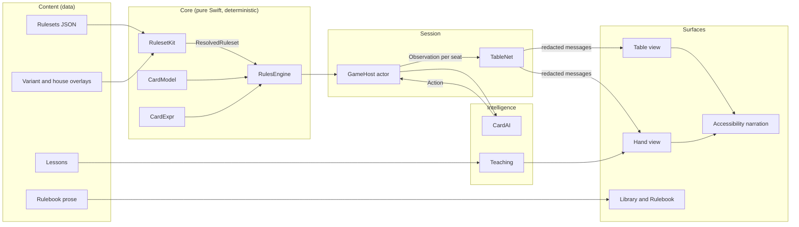
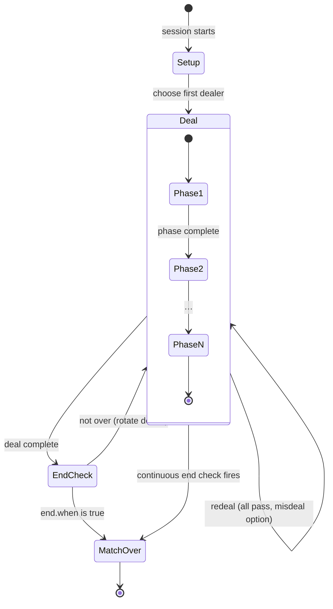
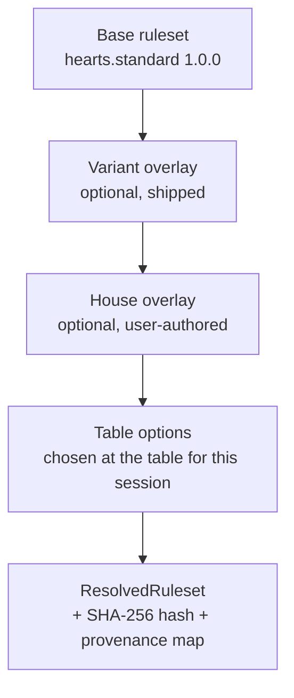
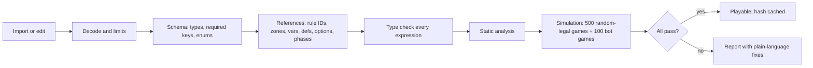
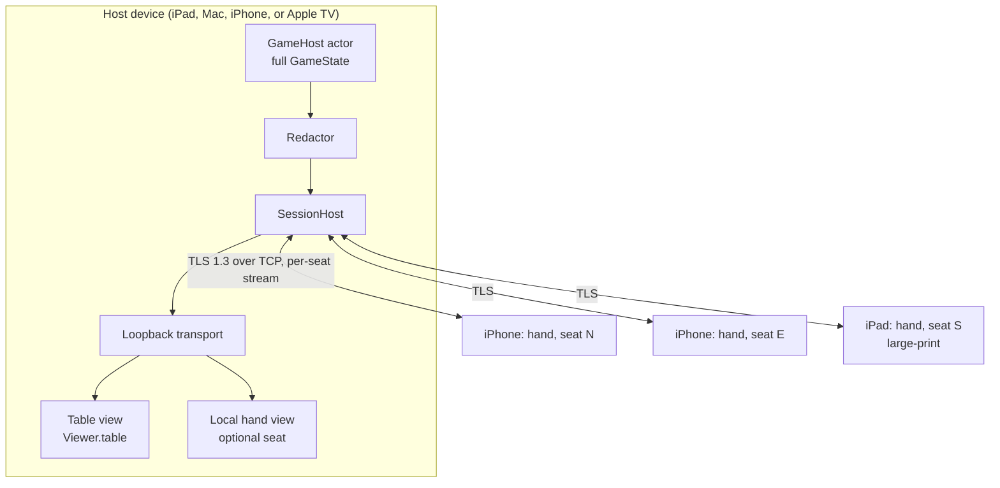

# Architecture

Version 1.0 · 2026-11-15 · Technical law for Parlor (see `README.md` §2 for precedence).

Contents: §1 Principles · §2 System Overview · §3 Module Layout · §4 Card Model and Decks · §5 Ruleset Format and Schema · §6 Worked Rulesets (Hearts, Euchre, Contract Bridge, Cribbage) · §7 CardExpr, the Expression Language · §8 Variant and Override Layering · §9 Engine Runtime, Observations, and Redaction · §10 Determinism, Seeded RNG, and Replays · §11 User-Authored Rules: Tiers, Sandbox, and Validation · §12 Networking: Host-Authoritative Sessions · §13 Device Roles and Play Configurations · §14 AI Opponents · §15 Teaching System · §16 Accessibility Architecture · §17 Rule Content, Licensing, and Citation · §18 Apple TV (tvOS) Plan · §19 Persistence, Stats, and Sync · §20 Security and Privacy Summary · §21 Architecture Decision Index

---

## 1. Principles

1. **Rules are data; mechanics are code.** Every game is a ruleset file that composes a fixed, tested library of Swift *mechanics* (deal, auction, pass, trick play, count play, draw and discard, and so on) and fills their parameters with small, safe *expressions*. Nothing a player creates or downloads is code.
2. **One engine, many surfaces.** The same deterministic engine powers solo play, pass-and-play, the multi-device table, online play, bots, lessons, the rulebook's interactive examples, and the command-line simulator.
3. **The host is the only source of truth.** One device (the host) holds the full game state. Every other device, and every UI on the host itself, sees only an *observation* redacted for its viewer.
4. **Every rejection has a reason.** Each legality check carries a rule ID, so the app can always answer "Why can't I play that?" in plain words.
5. **Comfort before flourish.** Tap-to-play everywhere (drag is optional), no time pressure by default, narrated events, large and high-contrast cards, and stable layouts. Mahler's grandparents are the design persona (`ROADMAP.md` §0.2).
6. **Provenance everywhere.** Every rule, variant, and house rule knows where it came from, and the rulebook shows how a table's rules differ from the standard.

---

## 2. System Overview



A **session** is one table: a resolved ruleset, a seat map, and a host. The **GameHost** actor owns `GameState`, applies actions, asks bots to move, and publishes per-seat **Observations**. **TableNet** carries observations and action intents between devices; when a surface is on the host device it uses an in-process loopback transport with exactly the same messages.

---

## 3. Module Layout

| Package | Purpose | Key Types | May Import |
| --- | --- | --- | --- |
| `CardModel` | Suits, ranks, cards, deck definitions, seats, teams | `Suit`, `Rank`, `CardFace`, `CardID`, `DeckSpec`, `DeckCatalog`, `Seat`, `Team`, `SeatSet` | Foundation (Codable only) |
| `CardExpr` | Expression language | `Lexer`, `Parser`, `AST`, `TypeChecker`, `Evaluator`, `Value`, `ExprType`, `Fuel`, `BuiltinRegistry` | CardModel |
| `RulesEngine` | State, actions, reducer, mechanics, redaction | `GameState` (`@_spi(HostOnly)`), `Action`, `ActionIntent`, `Transition`, `GameEvent`, `Mechanic` protocol and implementations, `Observation`, `Redactor`, `RuleViolation`, `SeededRNG`, `NativeFunctions` | CardModel, CardExpr, swift-collections |
| `RulesetKit` | Schema types, loader, overlay resolver, validator, simulator | `RulesetDocument`, `OverlayDocument`, `ResolvedRuleset`, `Resolver`, `Provenance`, `RulesetValidator`, `ValidationReport`, `Simulator`, `RulesDiff` | RulesEngine |
| `GameLibrary` | Built-in content and catalogue index | `Catalogue`, `CatalogueEntry`, `GameFamily`, bundled `Resources` | RulesetKit |
| `CardAI` | Bots | `Bot` protocol, `BotLevel`, `BeliefState`, `DealSampler`, `PIMCSearch`, `ISMCTS`, `HeuristicPolicy`, `BiddingSystem`, `BridgeSolver` (DDS wrapper), `CribbageEV` | RulesEngine, RulesetKit, vendored DDS |
| `Teaching` | Lessons, hints, explanations, trainers | `Lesson`, `LessonRunner`, `HintEngine`, `Explainer`, `Trainer` protocol | RulesEngine, RulesetKit, CardAI |
| `TableNet` | Sessions across devices | `SessionHost`, `SessionClient`, `Wire` messages, `Discovery`, `Pairing`, `SeatToken`, `LoopbackTransport`, `NetworkTransport`, `GameKitTransport` | RulesEngine (with `@_spi(HostOnly)` in `SessionHost` only), RulesetKit, Network, GameKit, swift-certificates |
| `TableUI` | Card and table rendering | `CardView`, `HandView`, `TableView`, `TrickView`, `SeatBadge`, `ScoreSheetView`, `AuctionBoxView`, `DeckTheme`, `CardFaceRenderer` | RulesEngine (Observation types only), SwiftUI |
| `Library` | Catalogue and rulebook UI | `LibraryView`, `GamePage`, `RulebookView`, `VariantCompareView`, `SearchIndex` | GameLibrary, RulesetKit, SwiftUI |
| `Accessibility` | Narration and comfort settings | `Narrator`, `EventPhraser`, `ComfortSettings`, `AudioCues`, `TableSummary` | RulesEngine (Observation), SwiftUI, AVFoundation |
| `Persistence` | Files | `SaveStore`, `ProfileStore`, `HouseRuleStore`, `StatsStore`, `FileVersioning` | RulesEngine (`@_spi(HostOnly)` for saves), RulesetKit |
| `Platform` | OS adapters | `Haptics`, `Speech`, `GameCenterService`, `CloudSync`, `HandoffService` | Apple frameworks |

**SPI rule:** `GameState` and the full-state accessors are `@_spi(HostOnly) public`. Only `RulesEngine`, `RulesetKit` (simulator), `TableNet.SessionHost`, `Persistence.SaveStore`, `Tools/rules-cli`, and tests may write `@_spi(HostOnly) import RulesEngine`. `Tools/check-imports.sh` greps for it and fails CI anywhere else. Bots and UI therefore *cannot* see hidden cards, by construction.

---

## 4. Card Model and Decks

### 4.1 Card Identity

```swift
public enum SuitSystem: String, Codable, Sendable { case french, german, swiss, latinSpanish, latinItalian, tarot }
public struct Suit: Hashable, Codable, Sendable { public let code: String }      // "S","H","D","C"; "Ei","Gr","Ro","Sc"; "Co","Ba","Es","Or"; "T" (tarot trumps)
public struct Rank: Hashable, Codable, Sendable { public let code: String }      // "2"…"10","J","Q","K","A"; "U","O" (Unter, Ober); "C" (Caballo); "1"…"21","Fool"
public struct CardFace: Hashable, Codable, Sendable { public let suit: Suit?; public let rank: Rank; public var id: String }  // "QS", "10H", "OEi", "T21", "Fool", "JokerBig"
public struct CardID: Hashable, Codable, Sendable { public let raw: UInt16 }      // Opaque per-deal instance ID; see §9.5
```

A `CardFace` is what a card *is*; a `CardID` is which physical copy it is *in this deal*. Duplicate decks (Pinochle, Bezique, Canasta, Doppelkopf) have several instances of one face. Rank codes are display-neutral; each ruleset defines its own orders (§5.4).

### 4.2 Deck Catalogue (Built In)

| Deck ID | Cards | Contents | Used By (Examples) |
| --- | --- | --- | --- |
| `french-52` | 52 | A–K × ♠♥♦♣ | Bridge, Hearts, Spades, Cribbage, Gin, Klondike |
| `french-52j1`, `french-52j2` | 53, 54 | Plus one or two jokers (`JokerBig`, `JokerLittle`) | Joker Spades, Canasta (doubled), Five Hundred |
| `french-104j4` | 108 | Two packs plus four jokers | Canasta, Hand and Foot (×n) |
| `euchre-24` / `euchre-25` | 24 / 25 | 9–A (plus joker as Benny) | Euchre |
| `piquet-32` | 32 | 7–A | Piquet, Belote, Skat (French faces), Écarté, Klaverjas |
| `pinochle-48` | 48 | 9–A doubled | Pinochle |
| `pinochle-80` | 80 | 10–A quadrupled | Double-deck Pinochle |
| `bezique-64` | 64 | Two piquet packs | Bezique |
| `doko-48` / `doko-40` | 48 / 40 | 9–A doubled, or without nines | Doppelkopf |
| `german-32` | 32 | 7–10, U, O, K, A (Daus) × Eichel, Grün, Herz, Schellen | Skat (German faces), Schafkopf, Sheepshead (French faces mapped) |
| `german-24` | 24 | 9–A German suits | Schnapsen variants (also 20-card) |
| `swiss-36` | 36 | 6–10 (Banner), U, O, K, A × Schellen, Rosen, Schilten, Eicheln | Jass |
| `french-36` | 36 | 6–A | Jass (French faces), Durak |
| `spanish-40` / `spanish-48` | 40 / 48 | 1–7, Sota, Caballo, Rey × Oros, Copas, Espadas, Bastos (48 adds 8–9) | Tute, Mus, Brisca, Escoba, Chinchón |
| `italian-40` | 40 | 1–7, Fante, Cavallo, Re × Coppe, Denari, Spade, Bastoni (regional face packs) | Scopa, Briscola, Tressette |
| `tarot-78` | 78 | 4 × 14 suit cards (with Knight), 21 trumps, Excuse (Fool) | French Tarot |
| `tarock-54` | 54 | Reduced suits plus 22 trumps | Königrufen |
| `custom` | any | A deck defined inline (Tier 3 user rules only, §11) | User games |

`DeckSpec` supports `base`, `copies`, `remove` (faces), `add` (faces), and `faces` (a face pack: `standard`, `fourColor`, `jumbo`, `highContrast`, regional Latin and German patterns). **Face art is separate from deck structure:** a German-suited game can be shown with French faces for players who prefer them (Mahler's grandparents' bridge club would never see an acorn unless they asked), and vice versa.

### 4.3 Seats and Teams

Seats are `0..<n` clockwise. `left(s, k)`, `right(s, k)`, `partner(s)`, `team(s)`, `opponents(t)` are builtins. Team layouts: `none`, `partnershipOpposite`, `dynamic` (teams decided in play, for example Schafkopf calls, Doppelkopf Re/Kontra, Sheepshead picker and partner; the dynamic team is hidden information until revealed and is redacted like a card).

---

## 5. Ruleset Format and Schema

### 5.1 Files

| Kind | `format` | File Suffix | Purpose |
| --- | --- | --- | --- |
| Base ruleset | `parlor.ruleset/1` | `.ruleset.json` | A complete game. |
| Variant overlay | `parlor.overlay/1`, `kind: "variant"` | `.variant.json` | A documented, named variant (Chicago bridge, Joker Spades). Ships with the app. |
| House overlay | `parlor.overlay/1`, `kind: "house"` | `.house.json` (shared as `.parlorrules`) | A player's customization. |
| Lesson | `parlor.lesson/1` | `.lesson.json` | A scripted teaching deal (§15). |
| Bidding system | `parlor.bidding/1` | `.bidding.json` | Bot and trainer bidding tables (§14.5). |

All files are UTF-8 JSON, no comments, keys in the order shown below (the validator warns on order; `rules-cli fmt` rewrites). Every localizable string is `{ "key": "...", "default": "English text" }`; house rules may use `{ "default": "..." }` only.

### 5.2 Top-Level Schema (Base Ruleset)

Notation: `?` optional; `Expr<T>` is a CardExpr string that type-checks to `T` (§7); `Effects` is an effect list (§5.7); `Text` is a localizable string object.

```
RulesetDocument {
  format: "parlor.ruleset/1"
  id: RulesetID                  // "hearts.standard"; game id + "." + ruleset slug
  game: GameID                   // "hearts"; groups rulesets in the catalogue
  kind: "base"
  version: SemVer                // ruleset content version; bump minor for options, major for meaning changes
  engine: VersionRange           // ">=1.0"; minimum engine (mechanics library) version
  name: Text
  summary: Text
  classification: { pagat: String, objective: Objective, tags: [String] }
  sources: [Source]              // ≥ 1, ≥ 1 with role "primary" or "official"
  players: { counts: [Int], default: Int, teams: TeamLayout, seatNames?: [String] }
  deck: DeckSpec
  orders: { [OrderName]: [RankCode] }      // low → high; "strains" for bridge-like ladders
  options: [OptionDecl]
  rules: [RuleDecl]              // every rule ID referenced anywhere must be declared here
  zones: [ZoneDecl]
  vars: { [VarName]: VarDecl }
  defs: { ["name(params) -> Type"]: Expr }  // named, non-recursive helper expressions
  setup: { firstDealer: DealerPick, dealerRotation: "left" | "right" | "alternate" | "fixed" | Expr<Seat> }
  phases: [Phase]                // the per-deal state machine, run in order unless `next` overrides
  end: EndDecl
  display: DisplayHints
  ai: { profile: AIProfileID, params: { [String]: JSONValue } }
  teaching?: { lessons: [LessonID] }
}

Source      { id, title, url, role: "primary" | "official" | "secondary" | "context", accessed?: Date }
OptionDecl  { id: camelCase, type: "bool" | "int" | "enum", default, min?, max?, values?, label: Text, help?: Text, rules: [RuleID], group?: String }
RuleDecl    { id: RuleID, text: Text, explain?: Text }      // explain = the "why" sentence used by the coach
ZoneDecl    { id, scope: "seat" | "team" | "shared", visibility: Visibility, ordered?: Bool, faceDown?: Bool, sort?: SortHint, owner?: Expr<Seat>, capacity?: Int }
Visibility  = "owner" | "team" | "public" | "none" | { seats: Expr<[Seat]> }
VarDecl     { scope: "match" | "deal" | "seatMatch" | "seatDeal" | "teamMatch" | "teamDeal", type: ExprTypeName, initial: Expr }
Phase       { id, mechanic: MechanicID, params: { … mechanic-specific … }, when?: Expr<Bool>, rule?: RuleID, before?: Effects, after?: Effects, next?: Expr<PhaseID> }
EndDecl     { check: "afterDeal" | "continuous" | "afterTrick", when: Expr<Bool>, rank: RankSpec, ties: "shared" | "playOff" | "impossible", rule: RuleID, matchEffects?: Effects, maxDeals?: Int }
```

A JSON Schema (draft 2020-12) mirroring this structure is generated in P2 to `Resources/Schemas/ruleset.schema.json` for editor tooling; the Swift `RulesetValidator` is authoritative.

### 5.3 Game Flow Model



A *match* is a sequence of *deals*; each deal runs the `phases` list. Phases whose `when` is false are skipped. A mechanic may end the deal early (`redeal`, `throwIn`) or the match (continuous end check).

### 5.4 Orders, Strength, and Effective Suit

`orders` name rank orders. Trick mechanics take:
- `order`: the default order name for comparing cards of one suit.
- `suitOf`: a def name `(c: card) -> suit` for the *effective* suit (Euchre's left bower, Doppelkopf's trump queens and jacks, Schafkopf's Obers and Unters). Default: printed suit.
- `strength`: a def name `(c: card) -> int` ranking cards *within* their effective suit. Default: index in `order`.
- `trump`: `Expr<Suit?>`; a trump of any strength beats any non-trump.

This three-part model (effective suit, within-suit strength, trump suit) covers every Pagat trick game in the catalogue without special cases; tarot's Excuse is handled by the `specialCards` parameter (§5.6).

### 5.5 Options

Options are the *only* way a ruleset exposes no-code customization. Each option names the rule IDs it affects, so the rulebook can render "House rule: no points on the first trick (changes rule HRT-3.3)". Options are typed, ranged, and defaulted; overlays may change defaults, add options, or lock options (`"locked": true`, for tournament-style rulesets such as ACC cribbage).

### 5.6 Mechanics Library (Engine 1.0)

Each mechanic is a Swift type conforming to:

```swift
public protocol Mechanic: Sendable {
  static var id: MechanicID { get }
  associatedtype Params: Codable & Sendable
  static func validate(_ params: Params, in ctx: ValidationContext) -> [ValidationIssue]
  static func enter(_ params: Params, state: inout GameState, ctx: EvalContext) throws(RuleViolation) -> [GameEvent]
  static func legalIntents(_ params: Params, state: GameState, seat: Seat, ctx: EvalContext) -> [ActionIntent]
  static func apply(_ params: Params, intent: ActionIntent, by seat: Seat, state: inout GameState, ctx: EvalContext) throws(RuleViolation) -> [GameEvent]
  static func isComplete(_ params: Params, state: GameState, ctx: EvalContext) -> PhaseOutcome   // .continue, .complete, .redeal, .endDeal
  static func pendingSeats(_ params: Params, state: GameState, ctx: EvalContext) -> SeatSet        // who must act now (several for simultaneous phases)
}
```

| Mechanic ID | Covers | Key Params | Wave |
| --- | --- | --- | --- |
| `deal` | Dealing packets to hands, kitties, widows, stock, layouts, turn-up cards | `source`, `packets[] {to, each \| count, faceUp?}`, `then: Effects` | 1 |
| `auction.ladder` | Contract bridge, Bid Whist, Five Hundred, Pinochle auctions, Skat bidding (with `ladder.values`) | `firstBidder`, `ladder {levels \| values, strains?}`, `calls[]`, `end`, `allPass`, `result`, `alerts` | 1 |
| `auction.rounds` | Euchre, Belote, Écarté proposals: fixed rounds of offers | `firstBidder`, `rounds[] {id, calls[] {id, allowed, sets, alone?, param?}}`, `endWhen`, `allPass` | 1 |
| `auction.individual` | Spades, Oh Hell, Wizard-style: each seat bids once from a range | `range`, `special[]` (nil, blind nil), `constraint` (Oh Hell dealer hook), `order` | 1 |
| `auction.raise` | Pinochle, Sheepshead pick-or-pass, Tarot contracts, Doppelkopf solos and announcements | `values`, `pickOrPass?`, `passIsFinal`, `contracts[]` | 2 |
| `exchange.pass` | Hearts passing, Pinochle partner passing, Canasta hand-and-foot transfers | `count`, `target`, `simultaneous`, `revealTo` | 1 |
| `exchange.kitty` | Euchre pickup, Skat Skat, Tarot Chien, Pinochle widow | `seat`, `take`, `discard`, `discardTo`, `restrictions`, `showTo` | 1 |
| `exchange.discardTo` | Cribbage crib, Piquet exchange | `count`, `from`, `to`, `simultaneous`, `revealTo` | 1 |
| `reveal.starter` | Cribbage starter, Gin up-card | `cutBy`, `from`, `to`, `minCutDepth` | 1 |
| `trick-play` | All trick-taking games | `tricks`, `activeSeats`, `trump`, `order`, `suitOf`, `strength`, `follow {mustFollow, mustTrumpIfVoid, mustOvertrump, mustHeadTrick, rule}`, `firstLeader`, `leadAllowed`, `playAllowed`, `winner`, `nextLeader`, `dummy`, `claims`, `specialCards` (Excuse, Benny), `onCardPlayed`, `onTrickEnd` | 1 |
| `count-play` | Cribbage pegging, Ninety-Nine, Ninety-Eight | `valueOf`, `limit`, `go`, `pointsOnPlay`, `award`, `returnCards` | 1 |
| `show` | Cribbage show, Piquet declarations, poker showdowns | `order[]`, `with`, `points`, `manual`, `muggins`, `award` | 1 |
| `draw-discard` | Rummy family, Gin, Canasta, 500 Rum, Hand and Foot, Golf | `drawFrom[]`, `pickupRules`, `meldRules {sets, runs, wild, minInitial}`, `layoff`, `knock {maxDeadwood, gin, undercut}`, `goOut`, `discardRequired`, `stockExhausted` | 1 (Gin), 2 |
| `meld.declare` | Pinochle and Bezique declarations, Belote, Jass Weis, Klaverjas roem | `table` (meld definitions), `when`, `scoreFn`, `revealTo` | 2 |
| `shed.match` | Crazy Eights, Uno-like matching, President (with `climb`), Durak (with `beat`) | `matchRule`, `specials[]`, `drawPenalty`, `climb?`, `beat?` | 1 |
| `ask` | Go Fish, Authors, Happy Families | `askFor` (rank \| face), `fromAnyOpponent`, `onSuccess`, `onFail`, `books` | 1 |
| `capture` | Scopa, Escoba, Cassino, Casino | `captureRule` (sum, match), `sweepBonus`, `builds?` | 3 |
| `layout.build` | Fan Tan (Sevens), Spite and Malice, Russian Bank (competitive patience) | `layout`, `placeRule`, `passPenalty` | 2 |
| `patience` | Klondike, FreeCell, Spider, Pyramid, Golf, Canfield, Yukon, Forty Thieves | `tableau`, `foundations`, `stock`, `waste`, `cells`, `buildRule`, `moveRule`, `dealRule`, `redeals`, `autoMove`, `winWhen` | 1 |
| `vying` | Poker, Brag, Mus envites, Bourré (play-money only, §17.4) | `rounds`, `betting` (limit, pot-limit, no-limit), `showdown`, `chips` | 3 |
| `score` | Applying scoring effects and player choices | `effects`, `choices[]` | 1 |
| `choose` | One seat picks from enumerated options (call a partner ace, declare a game type) | `seat`, `values`, `sets`, `revealTo` | 2 |

New mechanics are engine releases (code), reviewed by Claude and Grok, versioned by `engine`. Mechanics are deliberately broad and parameter-rich; the expected growth rate after Wave 3 is about one new mechanic per ten new games.

### 5.7 Effects (Bounded Statements)

Effects mutate match and deal variables and move cards. They are a tiny statement language with **no loops other than bounded `forEach` over seats or teams**, and **no recursion**:

```
Effect =
  { set: VarPath, to: Expr }                         // deal.trump, match.score[s]
| { add: VarPath, value: Expr<Int> }
| { let: Name, be: Expr }                            // local binding for the rest of this effect list
| { if: Expr<Bool>, then: Effects, else?: Effects, rule?: RuleID }
| { forEach: "seat" | "team" | "activeSeat", do: Effects }   // binds s or t
| { move: { from: ZoneRef, to: ZoneRef, toSeat?: Expr<Seat>, toTeam?: Expr<Team>, cards: "all" | Expr<[Card]> | "top(n)" } }
| { reveal: { zone: ZoneRef, seat?: Expr<Seat>, to: "all" | Expr<[Seat]> } }
| { emit: EventName, data?: { [String]: Expr } }     // narration and UI hooks (skunk, hisHeels, moonShot)
```

Each effect list has a static cost (sum of node costs, with `forEach` multiplied by player count) that must be below 50,000; the validator rejects anything above.

### 5.8 Native Functions (Whitelisted Pure Swift)

Some scoring is clearer and safer as tested Swift than as expressions. Native functions are pure, deterministic, versioned with the engine, and callable from CardExpr by name:

| Function | Signature | Notes |
| --- | --- | --- |
| `cribbage.handScore` | `(cards: [card], starter: card, isCrib: bool) -> int` | Fifteens, pairs, runs, flushes (crib requires five-card flush), nobs |
| `cribbage.pegPoints` | `(sequence: [card]) -> int` | Points for the latest card in the count sequence |
| `bridge.score` | `(contract, tricks: int, vulnerable: bool, mode: string) -> {below, above, defenders, total}` | Modes `rubber`, `chicago`, `duplicate`; laws-based tables |
| `bridge.honors` | `([seat: [card]], trump: suit?, team) -> int` | 100 or 150 honors |
| `rummy.melds` | `(cards, rules) -> {melds, deadwood}` | Optimal meld partition (exact, ≤ 11 cards brute-force; larger hands use DP) |
| `poker.handRank` | `(cards, rules) -> int` | Comparable rank; wild-card aware |
| `skat.gameValue` | `(declarer: [card], skat: [card], game, multipliers) -> int` | ISkO tables |
| `tarot.contractScore` | `(…) -> int` | FFT tables |
| `pinochle.meld` | `(cards, trump, table) -> int` | Single and double deck |

Adding a native function is an engine change; user-authored rules can call any registered native function but cannot add one.

### 5.9 Display Hints

`display` never affects rules. It selects a table layout (`fourAround`, `fourAroundPartners`, `bridgeCompass`, `headToHead`, `ring(n)`, `patienceTableau`, `rummyMelds`), the score sheet template, what to emphasize (trump, contract, vulnerability, the running count), and history depth. Unknown hints are ignored with a warning, so house rules cannot break layout.

---

## 6. Worked Rulesets

The full files are in `rulesets/`. They are normative examples: P3's conformance suites test them. Commentary below explains how each game maps onto the schema.

### 6.1 Hearts (`hearts.standard`)

What it demonstrates: per-deal derived values (`passOffset()`), a simultaneous pass with recipient-only reveal, lead and play restrictions with an `otherwise` fallback (you may break the restriction only when you have nothing else), a deal-scoped flag set by `onCardPlayed`, a player choice inside scoring (shooting the moon with the `shooterChooses` option), and low-score-wins ranking.

Key behaviors the engine must get right:
- **Fallbacks are per-card, then whole-hand.** `leadAllowed` filters the hand; if the filtered set is empty, `otherwise: "any"` permits the whole hand. The rejection message for a filtered card cites `HRT-3.4` and its `explain` text.
- **Pass reveal.** During `exchange.pass`, each passed `CardID` becomes known to the passer (already) and the recipient (on receipt); the other two seats learn only "3 cards passed left." The passer remembers what they passed (that knowledge persists in their observation).
- **Moon.** Penalty points are computed before bonuses so the jack of diamonds never prevents a moon.

```json
{
  "format": "parlor.ruleset/1",
  "id": "hearts.standard",
  "game": "hearts",
  "kind": "base",
  "version": "1.0.0",
  "engine": ">=1.0",
  "name": { "key": "game.hearts.name", "default": "Hearts" },
  "summary": { "key": "game.hearts.summary", "default": "Avoid taking hearts and the queen of spades, unless you can take them all." },
  "classification": { "pagat": "outplay/trick-taking/reverse", "objective": "avoid-capturing", "tags": ["trick-taking", "penalty", "no-trump", "passing"] },
  "sources": [
    { "id": "pagat", "title": "Pagat: Hearts", "url": "https://www.pagat.com/reverse/hearts.html", "role": "primary" },
    { "id": "yougov", "title": "YouGov: How Americans feel about 30 card games", "url": "https://yougov.com/en-us/articles/45795-how-americans-feel-about-30-card-games", "role": "context" }
  ],
  "players": { "counts": [4], "default": 4, "teams": "none" },
  "deck": { "base": "french-52" },
  "orders": { "natural": ["2", "3", "4", "5", "6", "7", "8", "9", "10", "J", "Q", "K", "A"] },
  "options": [
    { "id": "passSchedule", "type": "enum", "values": ["leftRightAcrossHold", "leftRightAcross", "leftOnly", "none"], "default": "leftRightAcrossHold", "label": { "key": "opt.hearts.passSchedule", "default": "Passing order" }, "rules": ["HRT-2.1"] },
    { "id": "passCount", "type": "int", "min": 1, "max": 4, "default": 3, "label": { "key": "opt.hearts.passCount", "default": "Cards passed" }, "rules": ["HRT-2.2"] },
    { "id": "noPointsFirstTrick", "type": "bool", "default": true, "label": { "key": "opt.hearts.noPointsFirstTrick", "default": "No points on the first trick" }, "rules": ["HRT-3.3"] },
    { "id": "breakingHearts", "type": "bool", "default": true, "label": { "key": "opt.hearts.breakingHearts", "default": "Hearts must be broken before they are led" }, "rules": ["HRT-3.4"] },
    { "id": "queenBreaksHearts", "type": "bool", "default": true, "label": { "key": "opt.hearts.queenBreaksHearts", "default": "The queen of spades breaks hearts" }, "rules": ["HRT-3.4"] },
    { "id": "moon", "type": "enum", "values": ["addToOthers", "subtractFromSelf", "shooterChooses"], "default": "addToOthers", "label": { "key": "opt.hearts.moon", "default": "Shooting the moon" }, "rules": ["HRT-4.3"] },
    { "id": "jackOfDiamonds", "type": "bool", "default": false, "label": { "key": "opt.hearts.jackOfDiamonds", "default": "Jack of diamonds scores minus 10" }, "rules": ["HRT-4.4"] },
    { "id": "target", "type": "int", "min": 25, "max": 500, "default": 100, "label": { "key": "opt.hearts.target", "default": "Game ends at" }, "rules": ["HRT-5.1"] }
  ],
  "rules": [
    { "id": "HRT-1.1", "text": { "key": "rule.hrt.1.1", "default": "Four players each receive 13 cards." } },
    { "id": "HRT-2.1", "text": { "key": "rule.hrt.2.1", "default": "Before play, each player passes cards in the direction for this deal." } },
    { "id": "HRT-2.2", "text": { "key": "rule.hrt.2.2", "default": "Each player chooses the cards to pass before seeing the cards received." } },
    { "id": "HRT-3.1", "text": { "key": "rule.hrt.3.1", "default": "The holder of the two of clubs leads it to the first trick." } },
    { "id": "HRT-3.2", "text": { "key": "rule.hrt.3.2", "default": "You must follow suit if you can; otherwise you may play any card." } },
    { "id": "HRT-3.3", "text": { "key": "rule.hrt.3.3", "default": "You may not play a heart or the queen of spades to the first trick unless you have nothing else." } },
    { "id": "HRT-3.4", "text": { "key": "rule.hrt.3.4", "default": "You may not lead a heart until hearts are broken, unless you hold only hearts." } },
    { "id": "HRT-3.5", "text": { "key": "rule.hrt.3.5", "default": "The highest card of the suit led wins the trick, and its winner leads next." } },
    { "id": "HRT-4.1", "text": { "key": "rule.hrt.4.1", "default": "Each heart taken scores 1 penalty point and the queen of spades scores 13." } },
    { "id": "HRT-4.3", "text": { "key": "rule.hrt.4.3", "default": "A player who takes all 26 penalty points shoots the moon." } },
    { "id": "HRT-4.4", "text": { "key": "rule.hrt.4.4", "default": "With this option, the jack of diamonds subtracts 10 points from its taker." } },
    { "id": "HRT-5.1", "text": { "key": "rule.hrt.5.1", "default": "When any player reaches the target, the player with the lowest score wins." } }
  ],
  "zones": [
    { "id": "hand", "scope": "seat", "visibility": "owner", "sort": "bySuitThenRank" },
    { "id": "passOut", "scope": "seat", "visibility": "owner" },
    { "id": "trick", "scope": "shared", "visibility": "public", "ordered": true },
    { "id": "taken", "scope": "seat", "visibility": "public", "faceDown": true }
  ],
  "vars": {
    "score": { "scope": "seatMatch", "type": "int", "initial": "0" },
    "dealPoints": { "scope": "seatDeal", "type": "int", "initial": "0" },
    "heartsBroken": { "scope": "deal", "type": "bool", "initial": "false" }
  },
  "defs": {
    "penalty(c: card) -> int": "c.suit == 'H' ? 1 : (c.id == 'QS' ? 13 : 0)",
    "bonus(c: card) -> int": "options.jackOfDiamonds && c.id == 'JD' ? -10 : 0",
    "passOffset() -> int": "options.passSchedule == 'none' ? 0 : (options.passSchedule == 'leftOnly' ? 1 : (options.passSchedule == 'leftRightAcross' ? [1, 3, 2][deal.index % 3] : [1, 3, 2, 0][deal.index % 4]))",
    "penaltyTaken(s: seat) -> int": "zone('taken', s).map(c, penalty(c)).sum()"
  },
  "setup": { "firstDealer": "randomCut", "dealerRotation": "left" },
  "phases": [
    { "id": "deal", "mechanic": "deal", "rule": "HRT-1.1", "params": { "packets": [ { "to": "hand", "each": 13 } ] } },
    {
      "id": "pass", "mechanic": "exchange.pass", "rule": "HRT-2.1",
      "when": "passOffset() != 0",
      "params": { "from": "hand", "via": "passOut", "to": "hand", "count": "options.passCount", "target": "left(seat, passOffset())", "simultaneous": true, "revealTo": "recipient" }
    },
    {
      "id": "play", "mechanic": "trick-play",
      "params": {
        "tricks": "untilHandsEmpty",
        "trump": "none",
        "order": "natural",
        "follow": { "mustFollow": true, "rule": "HRT-3.2" },
        "firstLeader": "holderOf('2C')",
        "leadAllowed": { "expr": "trick.number == 1 ? c.id == '2C' : (!options.breakingHearts || deal.heartsBroken || c.suit != 'H')", "otherwise": "any", "rule": "HRT-3.4" },
        "playAllowed": { "expr": "!(trick.number == 1 && options.noPointsFirstTrick && penalty(c) > 0)", "otherwise": "any", "rule": "HRT-3.3" },
        "winner": "highestOfLedSuit",
        "nextLeader": "winner",
        "onCardPlayed": [
          { "if": "c.suit == 'H' || (options.queenBreaksHearts && c.id == 'QS')", "then": [ { "set": "deal.heartsBroken", "to": "true" } ] }
        ],
        "onTrickEnd": [ { "move": { "from": "trick", "to": "taken", "toSeat": "trick.winner", "cards": "all" } } ]
      }
    },
    {
      "id": "score", "mechanic": "score", "rule": "HRT-4.1",
      "params": {
        "effects": [
          { "forEach": "seat", "do": [ { "set": "deal.dealPoints[s]", "to": "penaltyTaken(s) + zone('taken', s).map(c, bonus(c)).sum()" } ] },
          {
            "if": "seats().exists(s, penaltyTaken(s) == 26)",
            "then": [
              { "let": "shooter", "be": "seats().filter(s, penaltyTaken(s) == 26)[0]" },
              { "if": "options.moon == 'addToOthers' || (options.moon == 'shooterChooses' && choice('moon', shooter) == 'addToOthers')",
                "then": [ { "forEach": "seat", "do": [ { "set": "deal.dealPoints[s]", "to": "s == shooter ? zone('taken', s).map(c, bonus(c)).sum() : 26 + zone('taken', s).map(c, bonus(c)).sum()" } ] } ],
                "else": [ { "set": "deal.dealPoints[shooter]", "to": "-26 + zone('taken', shooter).map(c, bonus(c)).sum()" } ] }
            ],
            "rule": "HRT-4.3"
          },
          { "forEach": "seat", "do": [ { "add": "match.score[s]", "value": "deal.dealPoints[s]" } ] }
        ],
        "choices": [ { "id": "moon", "seat": "shooter", "when": "options.moon == 'shooterChooses'", "values": ["addToOthers", "subtractFromSelf"] } ]
      }
    }
  ],
  "end": { "check": "afterDeal", "when": "seats().exists(s, match.score[s] >= options.target)", "rank": "ascending(match.score)", "ties": "shared", "rule": "HRT-5.1" },
  "display": { "layout": "fourAround", "scoreSheet": ["dealPoints", "score"], "showLastTrick": true, "trickHistory": "lastOnly" },
  "ai": { "profile": "trick.generic", "params": { "avoidPoints": true, "moonAware": true } },
  "teaching": { "lessons": ["hearts.l1-basics", "hearts.l2-passing", "hearts.l3-moon"] }
}
```


### 6.2 Euchre (`euchre.standard`)

What it demonstrates: a 24-card deck, partnership teams, packet dealing with a turned up-card, a two-round offer auction (`auction.rounds`) with going alone, a conditional dealer pickup and discard, effective suit and strength defs for the bowers, `activeSeats` for a sitting-out partner, and tiered scoring.

Key behaviors:
- `suitOf` makes the left bower a trump for **follow-suit** purposes as well as for winning; `EUC-3.2` cites this in the "Why?" text.
- When the maker goes alone, the partner's hand is hidden from everyone (including the partner's own device, which shows "Sitting out this deal" with the hand dimmed but still private to its owner).
- `stickTheDealer` disables the dealer's pass in round two; the dealer's pass button is not offered at all (legal intents exclude it), and the rulebook marks the house rule.
- Common house rules ship as variant overlays (`euchre.canadian-loner`, `euchre.farmers-hand`, `euchre.benny` with a 25-card deck and joker as top trump, `euchre.bid-euchre` as its own game).

```json
{
  "format": "parlor.ruleset/1",
  "id": "euchre.standard",
  "game": "euchre",
  "kind": "base",
  "version": "1.0.0",
  "engine": ">=1.0",
  "name": {
    "key": "game.euchre.name",
    "default": "Euchre"
  },
  "summary": {
    "key": "game.euchre.summary",
    "default": "Partners name trump from a turned card and try to take three of five tricks."
  },
  "classification": {
    "pagat": "outplay/trick-taking/plain/euchre",
    "objective": "capture-tricks",
    "tags": [
      "trick-taking",
      "partnership",
      "trump",
      "bowers"
    ]
  },
  "sources": [
    {
      "id": "pagat",
      "title": "Pagat: Euchre",
      "url": "https://www.pagat.com/euchre/euchre.html",
      "role": "primary"
    },
    {
      "id": "wef",
      "title": "World Euchre Federation: Official Rules of Euchre",
      "url": "https://www.worldeuchrefederation.com/official-rules-of-euchre",
      "role": "official"
    }
  ],
  "players": {
    "counts": [
      4
    ],
    "default": 4,
    "teams": "partnershipOpposite"
  },
  "deck": {
    "base": "euchre-24"
  },
  "orders": {
    "natural": [
      "9",
      "10",
      "J",
      "Q",
      "K",
      "A"
    ]
  },
  "options": [
    {
      "id": "stickTheDealer",
      "type": "bool",
      "default": false,
      "label": {
        "key": "opt.euchre.stickTheDealer",
        "default": "Stick the dealer"
      },
      "rules": [
        "EUC-2.4"
      ]
    },
    {
      "id": "goingAlone",
      "type": "bool",
      "default": true,
      "label": {
        "key": "opt.euchre.goingAlone",
        "default": "Allow going alone"
      },
      "rules": [
        "EUC-2.5"
      ]
    },
    {
      "id": "alonePoints",
      "type": "int",
      "min": 2,
      "max": 6,
      "default": 4,
      "label": {
        "key": "opt.euchre.alonePoints",
        "default": "Points for a lone march"
      },
      "rules": [
        "EUC-4.3"
      ]
    },
    {
      "id": "target",
      "type": "int",
      "min": 5,
      "max": 15,
      "default": 10,
      "label": {
        "key": "opt.euchre.target",
        "default": "Game ends at"
      },
      "rules": [
        "EUC-5.1"
      ]
    }
  ],
  "rules": [
    {
      "id": "EUC-1.1",
      "text": {
        "key": "rule.euc.1.1",
        "default": "Each player receives five cards; the next card is turned face up."
      }
    },
    {
      "id": "EUC-2.1",
      "text": {
        "key": "rule.euc.2.1",
        "default": "In the first round, each player in turn may order the dealer to pick up the turned card, making its suit trump, or pass."
      }
    },
    {
      "id": "EUC-2.2",
      "text": {
        "key": "rule.euc.2.2",
        "default": "If trump is ordered, the dealer adds the turned card to their hand and discards one card face down."
      }
    },
    {
      "id": "EUC-2.3",
      "text": {
        "key": "rule.euc.2.3",
        "default": "If all pass, the card is turned down and each player in turn may name any other suit as trump, or pass."
      }
    },
    {
      "id": "EUC-2.4",
      "text": {
        "key": "rule.euc.2.4",
        "default": "If all pass twice, the cards are redealt by the next dealer; with stick the dealer, the dealer must name trump."
      }
    },
    {
      "id": "EUC-2.5",
      "text": {
        "key": "rule.euc.2.5",
        "default": "The player who makes trump may go alone; their partner sits out the deal."
      }
    },
    {
      "id": "EUC-3.1",
      "text": {
        "key": "rule.euc.3.1",
        "default": "The jack of trump (right bower) is the highest trump, and the jack of the same color (left bower) is the second highest and counts as a trump."
      }
    },
    {
      "id": "EUC-3.2",
      "text": {
        "key": "rule.euc.3.2",
        "default": "You must follow the suit led if you can, counting the left bower as trump."
      }
    },
    {
      "id": "EUC-3.3",
      "text": {
        "key": "rule.euc.3.3",
        "default": "The highest trump wins the trick, or the highest card of the suit led if no trump is played."
      }
    },
    {
      "id": "EUC-3.4",
      "text": {
        "key": "rule.euc.3.4",
        "default": "The player to the left of the dealer leads first; the winner of each trick leads the next."
      }
    },
    {
      "id": "EUC-4.1",
      "text": {
        "key": "rule.euc.4.1",
        "default": "Makers who take three or four tricks score 1 point; all five tricks score 2."
      }
    },
    {
      "id": "EUC-4.2",
      "text": {
        "key": "rule.euc.4.2",
        "default": "If the makers take fewer than three tricks, they are euchred and the defenders score 2."
      }
    },
    {
      "id": "EUC-4.3",
      "text": {
        "key": "rule.euc.4.3",
        "default": "A lone maker who takes all five tricks scores the lone-march points."
      }
    },
    {
      "id": "EUC-5.1",
      "text": {
        "key": "rule.euc.5.1",
        "default": "The first partnership to reach the target wins."
      }
    }
  ],
  "zones": [
    {
      "id": "hand",
      "scope": "seat",
      "visibility": "owner",
      "sort": "trumpFirst"
    },
    {
      "id": "kitty",
      "scope": "shared",
      "visibility": "none"
    },
    {
      "id": "upcard",
      "scope": "shared",
      "visibility": "public"
    },
    {
      "id": "discard",
      "scope": "shared",
      "visibility": "none"
    },
    {
      "id": "trick",
      "scope": "shared",
      "visibility": "public",
      "ordered": true
    },
    {
      "id": "taken",
      "scope": "team",
      "visibility": "public",
      "faceDown": true
    }
  ],
  "vars": {
    "score": {
      "scope": "teamMatch",
      "type": "int",
      "initial": "0"
    },
    "trump": {
      "scope": "deal",
      "type": "suit?",
      "initial": "null"
    },
    "maker": {
      "scope": "deal",
      "type": "seat?",
      "initial": "null"
    },
    "alone": {
      "scope": "deal",
      "type": "bool",
      "initial": "false"
    }
  },
  "defs": {
    "isRight(c: card) -> bool": "deal.trump != null && c.rank == 'J' && c.suit == deal.trump",
    "isLeft(c: card) -> bool": "deal.trump != null && c.rank == 'J' && c.suit != deal.trump && colorOf(c.suit) == colorOf(deal.trump)",
    "suitOf(c: card) -> suit": "isLeft(c) ? deal.trump : c.suit",
    "strength(c: card) -> int": "isRight(c) ? 100 : (isLeft(c) ? 99 : rankIndex('natural', c.rank))"
  },
  "setup": {
    "firstDealer": "firstJack",
    "dealerRotation": "left"
  },
  "phases": [
    {
      "id": "deal",
      "mechanic": "deal",
      "rule": "EUC-1.1",
      "params": {
        "packets": [
          {
            "to": "hand",
            "each": 3
          },
          {
            "to": "hand",
            "each": 2
          },
          {
            "to": "kitty",
            "count": 4
          }
        ],
        "then": [
          {
            "move": {
              "from": "kitty",
              "to": "upcard",
              "cards": "top(1)"
            }
          }
        ]
      }
    },
    {
      "id": "bid",
      "mechanic": "auction.rounds",
      "params": {
        "firstBidder": "left(dealer, 1)",
        "rounds": [
          {
            "id": "orderUp",
            "rule": "EUC-2.1",
            "calls": [
              {
                "id": "pass"
              },
              {
                "id": "orderUp",
                "sets": [
                  {
                    "set": "deal.trump",
                    "to": "zone('upcard')[0].suit"
                  }
                ],
                "alone": "options.goingAlone"
              }
            ]
          },
          {
            "id": "nameTrump",
            "rule": "EUC-2.3",
            "before": [
              {
                "move": {
                  "from": "upcard",
                  "to": "discard",
                  "cards": "all"
                }
              }
            ],
            "calls": [
              {
                "id": "pass",
                "allowed": "!(options.stickTheDealer && seat == dealer)"
              },
              {
                "id": "name",
                "param": "suit",
                "allowed": "param != zone('discard')[0].suit",
                "sets": [
                  {
                    "set": "deal.trump",
                    "to": "param"
                  }
                ],
                "alone": "options.goingAlone"
              }
            ]
          }
        ],
        "onCall": [
          {
            "if": "call.id != 'pass'",
            "then": [
              {
                "set": "deal.maker",
                "to": "seat"
              },
              {
                "set": "deal.alone",
                "to": "call.alone"
              }
            ]
          }
        ],
        "endWhen": "deal.trump != null",
        "allPass": {
          "action": "redeal",
          "rule": "EUC-2.4"
        }
      }
    },
    {
      "id": "pickup",
      "mechanic": "exchange.kitty",
      "rule": "EUC-2.2",
      "when": "zone('upcard').size() == 1",
      "params": {
        "seat": "dealer",
        "take": "upcard",
        "discard": 1,
        "discardTo": "discard",
        "skipIf": "deal.alone && dealer == partner(deal.maker)"
      }
    },
    {
      "id": "play",
      "mechanic": "trick-play",
      "params": {
        "tricks": "untilHandsEmpty",
        "activeSeats": "deal.alone ? seats().filter(s, s != partner(deal.maker)) : seats()",
        "trump": "deal.trump",
        "suitOf": "suitOf",
        "strength": "strength",
        "follow": {
          "mustFollow": true,
          "rule": "EUC-3.2"
        },
        "firstLeader": "nextActive(left(dealer, 1))",
        "winner": "highestTrumpElseLedSuit",
        "winnerRule": "EUC-3.3",
        "nextLeader": "winner",
        "onTrickEnd": [
          {
            "move": {
              "from": "trick",
              "to": "taken",
              "toTeam": "team(trick.winner)",
              "cards": "all"
            }
          }
        ]
      }
    },
    {
      "id": "score",
      "mechanic": "score",
      "params": {
        "effects": [
          {
            "let": "t",
            "be": "tricksWon(team(deal.maker))"
          },
          {
            "if": "t == 5 && deal.alone",
            "then": [
              {
                "add": "match.score[team(deal.maker)]",
                "value": "options.alonePoints"
              }
            ],
            "rule": "EUC-4.3",
            "else": [
              {
                "if": "t == 5",
                "then": [
                  {
                    "add": "match.score[team(deal.maker)]",
                    "value": "2"
                  }
                ],
                "rule": "EUC-4.1",
                "else": [
                  {
                    "if": "t >= 3",
                    "then": [
                      {
                        "add": "match.score[team(deal.maker)]",
                        "value": "1"
                      }
                    ],
                    "rule": "EUC-4.1",
                    "else": [
                      {
                        "add": "match.score[opponents(team(deal.maker))]",
                        "value": "2"
                      }
                    ]
                  }
                ]
              }
            ]
          }
        ]
      }
    }
  ],
  "end": {
    "check": "afterDeal",
    "when": "teams().exists(t, match.score[t] >= options.target)",
    "rank": "descending(match.score)",
    "ties": "impossible",
    "rule": "EUC-5.1"
  },
  "display": {
    "layout": "fourAroundPartners",
    "scoreSheet": [
      "score"
    ],
    "showTrump": true,
    "showMaker": true,
    "trickHistory": "lastOnly"
  },
  "ai": {
    "profile": "trick.euchre",
    "params": {}
  },
  "teaching": {
    "lessons": [
      "euchre.l1-bowers",
      "euchre.l2-ordering-up",
      "euchre.l3-going-alone"
    ]
  }
}
```


### 6.3 Contract Bridge, Rubber (`contract-bridge.rubber`)

What it demonstrates: a bidding ladder with doubles and redoubles, declarer determination, a dummy revealed after the opening lead and controlled by the declarer, native scoring (`bridge.score`, `bridge.honors`), match-level rubber state (below and above the line, games won, vulnerability as a def), claims, and an alerting hook that lets bots explain their bids.

Key behaviors:
- **Dummy routing.** When it is dummy's turn, `pendingSeats` returns the dummy seat but `controlledBy` makes the *declarer's* device the actor. The declarer's hand device shows dummy's cards above their own; the table shows dummy face up in front of the dummy seat. Dummy's own device shows its hand face up, marked "Dummy," with no actions (it may still view everything public, and may be used to coach if the table allows).
- **Auction legality** follows Laws of Duplicate Bridge 2017 Laws 18–19 for sufficiency, doubles, and redoubles; insufficient bids, bids out of turn, and other irregularities simply cannot happen in Parlor (the hand device offers only legal calls), so Laws 25–39 rectification is out of scope.
- **Bidding boxes.** The hand device's bidding control mirrors a bidding box: levels 1–7 and strains, with Pass, Double, and Redouble as large separate buttons; illegal calls are visibly absent.
- **Variants** are overlays: `contract-bridge.chicago` (shown below), `contract-bridge.duplicate` (board scoring with fixed vulnerability by board number and optional pre-dealt PBN boards), `contract-bridge.honeymoon` (two players with semi-exposed dummies), and a Tier 1 option `honors`.

```json
{
  "format": "parlor.ruleset/1",
  "id": "contract-bridge.rubber",
  "game": "contract-bridge",
  "kind": "base",
  "version": "1.0.0",
  "engine": ">=1.0",
  "name": { "key": "game.bridge.name", "default": "Contract Bridge (Rubber)" },
  "summary": { "key": "game.bridge.summary", "default": "Partners bid for a contract, then the declarer plays both hands to make it." },
  "classification": { "pagat": "outplay/trick-taking/plain/whist/bridge", "objective": "capture-tricks", "tags": ["trick-taking", "partnership", "auction", "dummy"] },
  "sources": [
    { "id": "pagat", "title": "Pagat: Contract Bridge", "url": "https://www.pagat.com/auctionwhist/bridge.html", "role": "primary" },
    { "id": "acbl-rubber", "title": "ACBL: Laws of Rubber Bridge (2014)", "url": "https://cdn.acbl.org/wp-content/uploads/2015/02/Laws-of-Rubber-Bridge.pdf", "role": "official" },
    { "id": "wbf-2017", "title": "WBF: 2017 Laws of Duplicate Bridge", "url": "https://www.worldbridge.org/regulations/2017-laws-of-duplicate-bridge/", "role": "official" }
  ],
  "players": { "counts": [4], "default": 4, "teams": "partnershipOpposite", "seatNames": ["N", "E", "S", "W"] },
  "deck": { "base": "french-52" },
  "orders": { "natural": ["2", "3", "4", "5", "6", "7", "8", "9", "10", "J", "Q", "K", "A"], "strains": ["C", "D", "H", "S", "NT"] },
  "options": [
    { "id": "honors", "type": "bool", "default": true, "label": { "key": "opt.bridge.honors", "default": "Score honors" }, "rules": ["BRG-5.6"] },
    { "id": "passOut", "type": "enum", "values": ["redealNextDealer", "redealSameDealer"], "default": "redealNextDealer", "label": { "key": "opt.bridge.passOut", "default": "After four passes" }, "rules": ["BRG-2.6"] },
    { "id": "claims", "type": "bool", "default": true, "label": { "key": "opt.bridge.claims", "default": "Declarer may claim remaining tricks" }, "rules": ["BRG-4.6"] }
  ],
  "rules": [
    { "id": "BRG-1.1", "text": { "key": "rule.brg.1.1", "default": "Four players in two partnerships each receive 13 cards." } },
    { "id": "BRG-2.1", "text": { "key": "rule.brg.2.1", "default": "The dealer calls first; each player in turn passes, bids, doubles, or redoubles." } },
    { "id": "BRG-2.2", "text": { "key": "rule.brg.2.2", "default": "A bid names a number of tricks over six (1 to 7) and a strain; each bid must be higher than the last, ranking clubs, diamonds, hearts, spades, then no trump." } },
    { "id": "BRG-2.3", "text": { "key": "rule.brg.2.3", "default": "You may double only the opponents' last bid, if not already doubled; you may redouble only your side's doubled bid." } },
    { "id": "BRG-2.4", "text": { "key": "rule.brg.2.4", "default": "The auction ends after three consecutive passes following a bid." } },
    { "id": "BRG-2.5", "text": { "key": "rule.brg.2.5", "default": "The declarer is the player of the winning side who first named the final strain." } },
    { "id": "BRG-2.6", "text": { "key": "rule.brg.2.6", "default": "If all four players pass, the deal is thrown in and redealt." } },
    { "id": "BRG-3.1", "text": { "key": "rule.brg.3.1", "default": "The player to the declarer's left makes the opening lead." } },
    { "id": "BRG-3.2", "text": { "key": "rule.brg.3.2", "default": "After the opening lead, the declarer's partner (dummy) spreads their hand face up, and the declarer plays it." } },
    { "id": "BRG-4.1", "text": { "key": "rule.brg.4.1", "default": "You must follow suit if you can." } },
    { "id": "BRG-4.2", "text": { "key": "rule.brg.4.2", "default": "The highest trump wins the trick, or the highest card of the suit led if no trump is played." } },
    { "id": "BRG-4.6", "text": { "key": "rule.brg.4.6", "default": "The declarer may claim the remaining tricks; defenders may accept or play on." } },
    { "id": "BRG-5.1", "text": { "key": "rule.brg.5.1", "default": "Making the contract scores trick points below the line; 100 or more below the line wins a game." } },
    { "id": "BRG-5.2", "text": { "key": "rule.brg.5.2", "default": "Overtricks, slam bonuses, insult bonuses, and penalties for undertricks score above the line." } },
    { "id": "BRG-5.5", "text": { "key": "rule.brg.5.5", "default": "The first side to win two games wins the rubber and its bonus." } },
    { "id": "BRG-5.6", "text": { "key": "rule.brg.5.6", "default": "A player holding four or five trump honors, or all four aces at no trump, scores an honors bonus." } }
  ],
  "zones": [
    { "id": "hand", "scope": "seat", "visibility": "owner", "sort": "bridgeSuits" },
    { "id": "trick", "scope": "shared", "visibility": "public", "ordered": true },
    { "id": "played", "scope": "seat", "visibility": "public", "faceDown": true }
  ],
  "vars": {
    "below": { "scope": "teamMatch", "type": "int", "initial": "0" },
    "above": { "scope": "teamMatch", "type": "int", "initial": "0" },
    "games": { "scope": "teamMatch", "type": "int", "initial": "0" },
    "contract": { "scope": "deal", "type": "contract?", "initial": "null" },
    "declarer": { "scope": "deal", "type": "seat?", "initial": "null" }
  },
  "defs": {
    "vulnerable(t: team) -> bool": "match.games[t] >= 1",
    "strainSuit() -> suit?": "deal.contract.strain == 'NT' ? null : deal.contract.strain",
    "declarerTricks() -> int": "tricksWon(team(deal.declarer))"
  },
  "setup": { "firstDealer": "highCut", "dealerRotation": "left" },
  "phases": [
    { "id": "deal", "mechanic": "deal", "rule": "BRG-1.1", "params": { "packets": [ { "to": "hand", "each": 13 } ] } },
    {
      "id": "auction", "mechanic": "auction.ladder",
      "params": {
        "firstBidder": "dealer",
        "ladder": { "levels": [1, 7], "strains": "strains", "rule": "BRG-2.2" },
        "calls": ["pass", "double", "redouble"],
        "doubleRule": "BRG-2.3",
        "end": { "consecutivePassesAfterBid": 3, "rule": "BRG-2.4" },
        "allPass": { "action": "options.passOut == 'redealNextDealer' ? 'redealNextDealer' : 'redealSameDealer'", "rule": "BRG-2.6" },
        "result": { "contract": "deal.contract", "declarer": { "set": "deal.declarer", "rule": "firstOfWinningSideToNameStrain", "ruleId": "BRG-2.5" } },
        "alerts": "systemExplanations"
      }
    },
    {
      "id": "play", "mechanic": "trick-play",
      "params": {
        "tricks": 13,
        "trump": "strainSuit()",
        "order": "natural",
        "follow": { "mustFollow": true, "rule": "BRG-4.1" },
        "firstLeader": "left(deal.declarer, 1)",
        "firstLeaderRule": "BRG-3.1",
        "dummy": { "seat": "partner(deal.declarer)", "revealAfter": "openingLead", "controlledBy": "deal.declarer", "rule": "BRG-3.2" },
        "winner": "highestTrumpElseLedSuit",
        "winnerRule": "BRG-4.2",
        "nextLeader": "winner",
        "claims": { "enabled": "options.claims", "by": "deal.declarer", "acceptedBy": "defenders", "rule": "BRG-4.6" },
        "onTrickEnd": [ { "forEach": "seat", "do": [ { "move": { "from": "trick", "to": "played", "toSeat": "s", "cards": "playedBy(s)" } } ] } ]
      }
    },
    {
      "id": "score", "mechanic": "score",
      "when": "deal.contract != null",
      "params": {
        "effects": [
          { "let": "dt", "be": "team(deal.declarer)" },
          { "let": "r", "be": "bridge.score(deal.contract, declarerTricks(), vulnerable(dt), 'rubber')" },
          { "add": "match.below[dt]", "value": "r.below", "rule": "BRG-5.1" },
          { "add": "match.above[dt]", "value": "r.above", "rule": "BRG-5.2" },
          { "add": "match.above[opponents(dt)]", "value": "r.defenders", "rule": "BRG-5.2" },
          { "if": "options.honors", "then": [ { "forEach": "team", "do": [ { "add": "match.above[t]", "value": "bridge.honors(dealtHands(), strainSuit(), t)" } ] } ], "rule": "BRG-5.6" },
          { "if": "match.below[dt] >= 100", "then": [ { "add": "match.games[dt]", "value": "1" }, { "forEach": "team", "do": [ { "add": "match.above[t]", "value": "match.below[t]" }, { "set": "match.below[t]", "to": "0" } ] } ], "rule": "BRG-5.1" },
          { "if": "match.games[dt] == 2", "then": [ { "add": "match.above[dt]", "value": "match.games[opponents(dt)] == 0 ? 700 : 500" } ], "rule": "BRG-5.5" }
        ]
      }
    }
  ],
  "end": { "check": "afterDeal", "when": "teams().exists(t, match.games[t] == 2)", "rank": "descending(match.above)", "ties": "shared", "rule": "BRG-5.5" },
  "display": { "layout": "bridgeCompass", "scoreSheet": "bridgeRubber", "showContract": true, "showVulnerability": true, "trickHistory": "all", "auctionBox": true },
  "ai": { "profile": "bridge", "params": { "biddingSystem": "parlor-standard-sayc", "playSolver": "dds-pimc" } },
  "teaching": { "lessons": ["bridge.l1-tricks", "bridge.l2-trumps", "bridge.l3-dummy", "bridge.l4-opening-bids", "bridge.l5-responses", "bridge.l6-scoring"] }
}
```

The Chicago overlay replaces vulnerability and scoring and ends after four deals:

```json
{
  "format": "parlor.overlay/1",
  "id": "contract-bridge.chicago",
  "kind": "variant",
  "extends": "contract-bridge.rubber@^1.0",
  "version": "1.0.0",
  "name": { "key": "game.bridge.chicago.name", "default": "Contract Bridge (Chicago)" },
  "sources": [ { "id": "pagat-chicago", "title": "Pagat: Chicago (four-deal bridge)", "url": "https://www.pagat.com/auctionwhist/bridge.html#chicago", "role": "primary" } ],
  "patch": [
    { "op": "replace", "path": "/vars/dealsPlayed", "value": { "scope": "match", "type": "int", "initial": "0" } },
    { "op": "replace", "path": "/defs/vulnerable(t: team) -> bool", "value": "[[false, false], [true, false], [false, true], [true, true]][match.dealsPlayed % 4][t]", "note": "Deal 1 none, 2 dealer side (N-S when North deals first), 3 dealer side, 4 both; simplified to N-S/E-W indexing." },
    { "op": "replace", "path": "/options/byId/passOut/default", "value": "redealSameDealer" },
    { "op": "replace", "path": "/phases/byId/score/params/effects", "value": [
      { "let": "dt", "be": "team(deal.declarer)" },
      { "let": "r", "be": "bridge.score(deal.contract, declarerTricks(), vulnerable(dt), 'chicago')" },
      { "add": "match.above[dt]", "value": "r.total" },
      { "add": "match.above[opponents(dt)]", "value": "r.defenders" }
    ] },
    { "op": "append", "path": "/phases/byId/score/params/effects", "value": { "add": "match.dealsPlayed", "value": "1" } },
    { "op": "replace", "path": "/phases/byId/score/when", "value": "true" },
    { "op": "replace", "path": "/end", "value": { "check": "afterDeal", "when": "match.dealsPlayed == 4", "rank": "descending(match.above)", "ties": "shared", "rule": "BRG-C.1" } },
    { "op": "append", "path": "/rules", "value": { "id": "BRG-C.1", "text": { "key": "rule.brg.c.1", "default": "A Chicago chukker is four deals with fixed vulnerability; part-scores carry, and a part-score bonus is scored on the fourth deal." } } }
  ]
}
```


### 6.4 Cribbage, Six-Card (`cribbage.six-card`)

What it demonstrates: a two-player game with a shared hidden crib owned by the dealer, a cut-and-turn starter with an immediate bonus, the `count-play` mechanic (pegging to 31 with go), the `show` mechanic with an ordered counting sequence, optional manual counting with muggins, a **continuous** end check (the game ends the moment a player reaches 121, even mid-show, which is why counting order matters), and skunk detection.

Key behaviors:
- **Counting order is law.** `show.order` enforces non-dealer, dealer, then crib (ACC Rule 9.2 analogue); a non-dealer who reaches 121 on their hand wins before the dealer counts.
- **Manual counting mode** (option) asks each player to enter their count on their hand device with large number buttons; with muggins on, the opponent may claim the missed points. Default is automatic counting with a visible breakdown ("Fifteen two, fifteen four, a pair is six…") narrated aloud, which teaches as it scores.
- **The board.** `display.board: "cribbage121"` draws a pegging board on the table and a compact score track on hand devices.
- Variants: `cribbage.five-card` (five cards each, two to the crib from each player, three extra points to the non-dealer at the start, 61 holes, per Pagat's five-card page), `cribbage.three-player`, `cribbage.four-player` (partners), and an `acc.tournament` overlay that locks options to ACC rules (muggins on, manual counting).

```json
{
  "format": "parlor.ruleset/1",
  "id": "cribbage.six-card",
  "game": "cribbage",
  "kind": "base",
  "version": "1.0.0",
  "engine": ">=1.0",
  "name": { "key": "game.cribbage.name", "default": "Cribbage" },
  "summary": { "key": "game.cribbage.summary", "default": "Score combinations of fifteens, pairs, runs, and flushes in play and in hand; first to 121 wins." },
  "classification": { "pagat": "outplay/adding/cribbage", "objective": "score-points", "tags": ["adding", "two-player", "board"] },
  "sources": [
    { "id": "acc", "title": "American Cribbage Congress: Cribbage Tournament Rules (2025)", "url": "https://cribbage.org/NewSite/rules/rulebook_2025.pdf", "role": "official" },
    { "id": "pagat", "title": "Pagat: Cribbage", "url": "https://www.pagat.com/adders/crib6.html", "role": "primary" }
  ],
  "players": { "counts": [2], "default": 2, "teams": "none" },
  "deck": { "base": "french-52" },
  "orders": { "natural": ["A", "2", "3", "4", "5", "6", "7", "8", "9", "10", "J", "Q", "K"] },
  "options": [
    { "id": "target", "type": "enum", "values": ["121", "61"], "default": "121", "label": { "key": "opt.crib.target", "default": "Game length" }, "rules": ["CRB-6.1"] },
    { "id": "muggins", "type": "bool", "default": false, "label": { "key": "opt.crib.muggins", "default": "Muggins (claim points your opponent misses)" }, "rules": ["CRB-5.4"] },
    { "id": "manualCounting", "type": "bool", "default": false, "label": { "key": "opt.crib.manualCounting", "default": "Players count their own hands" }, "rules": ["CRB-5.4"] },
    { "id": "skunks", "type": "bool", "default": true, "label": { "key": "opt.crib.skunks", "default": "Count skunks in match play" }, "rules": ["CRB-6.2"] }
  ],
  "rules": [
    { "id": "CRB-1.1", "text": { "key": "rule.crb.1.1", "default": "Each player receives six cards." } },
    { "id": "CRB-2.1", "text": { "key": "rule.crb.2.1", "default": "Each player lays away two cards face down to form the crib, which belongs to the dealer." } },
    { "id": "CRB-3.1", "text": { "key": "rule.crb.3.1", "default": "The non-dealer cuts and the dealer turns the top card of the lower packet as the starter." } },
    { "id": "CRB-3.2", "text": { "key": "rule.crb.3.2", "default": "If the starter is a jack, the dealer pegs 2 (his heels)." } },
    { "id": "CRB-4.1", "text": { "key": "rule.crb.4.1", "default": "Players alternately play cards, announcing the running total, which may not exceed 31." } },
    { "id": "CRB-4.2", "text": { "key": "rule.crb.4.2", "default": "A player who cannot play without passing 31 says go; the opponent continues if able." } },
    { "id": "CRB-4.3", "text": { "key": "rule.crb.4.3", "default": "Fifteens, pairs, and runs formed in play score; reaching 31 scores 2, and the last card under 31 scores 1." } },
    { "id": "CRB-5.1", "text": { "key": "rule.crb.5.1", "default": "Hands are counted in order: non-dealer, dealer, then the dealer's crib, each with the starter." } },
    { "id": "CRB-5.2", "text": { "key": "rule.crb.5.2", "default": "Fifteens score 2, pairs 2, runs 1 per card, a four-card flush 4 (hand only), a five-card flush 5, and the jack of the starter's suit 1." } },
    { "id": "CRB-5.4", "text": { "key": "rule.crb.5.4", "default": "With muggins, an opponent may claim points a player fails to count." } },
    { "id": "CRB-6.1", "text": { "key": "rule.crb.6.1", "default": "The first player to reach the target wins immediately, even mid-play." } },
    { "id": "CRB-6.2", "text": { "key": "rule.crb.6.2", "default": "A loser who fails to pass 90 (in a 121 game) is skunked." } }
  ],
  "zones": [
    { "id": "stock", "scope": "shared", "visibility": "none" },
    { "id": "hand", "scope": "seat", "visibility": "owner", "sort": "byRank" },
    { "id": "crib", "scope": "shared", "visibility": "none", "owner": "dealer" },
    { "id": "starter", "scope": "shared", "visibility": "public" },
    { "id": "pegged", "scope": "seat", "visibility": "public" },
    { "id": "count", "scope": "shared", "visibility": "public", "ordered": true }
  ],
  "vars": {
    "score": { "scope": "seatMatch", "type": "int", "initial": "0" },
    "games": { "scope": "seatMatch", "type": "int", "initial": "0" }
  },
  "defs": {
    "target() -> int": "options.target == '61' ? 61 : 121",
    "pone() -> seat": "left(dealer, 1)"
  },
  "setup": { "firstDealer": "lowCut", "dealerRotation": "alternate" },
  "phases": [
    { "id": "deal", "mechanic": "deal", "rule": "CRB-1.1", "params": { "source": "stock", "packets": [ { "to": "hand", "each": 6 } ] } },
    { "id": "layAway", "mechanic": "exchange.discardTo", "rule": "CRB-2.1", "params": { "count": 2, "from": "hand", "to": "crib", "simultaneous": true, "revealTo": "nobody" } },
    {
      "id": "starter", "mechanic": "reveal.starter", "rule": "CRB-3.1",
      "params": { "cutBy": "pone()", "from": "stock", "to": "starter", "minCutDepth": 4 },
      "after": [ { "if": "zone('starter')[0].rank == 'J'", "then": [ { "add": "match.score[dealer]", "value": "2", "event": "hisHeels" } ], "rule": "CRB-3.2" } ]
    },
    {
      "id": "pegging", "mechanic": "count-play",
      "params": {
        "from": "hand", "to": "pegged", "sequence": "count",
        "firstPlayer": "pone()",
        "valueOf": "c.rank == 'A' ? 1 : (['J', 'Q', 'K'].exists(r, r == c.rank) ? 10 : int(c.rank))",
        "limit": 31,
        "rule": "CRB-4.1",
        "go": { "rule": "CRB-4.2", "lastCardPoints": 1, "exactLimitPoints": 2 },
        "pointsOnPlay": "cribbage.pegPoints(zone('count'))",
        "pointsRule": "CRB-4.3",
        "award": "match.score[seat]",
        "returnCards": true
      }
    },
    {
      "id": "show", "mechanic": "show", "rule": "CRB-5.1",
      "params": {
        "order": [
          { "zone": "hand", "seat": "pone()", "award": "pone()" },
          { "zone": "hand", "seat": "dealer", "award": "dealer" },
          { "zone": "crib", "award": "dealer", "isCrib": true }
        ],
        "with": "starter",
        "points": "cribbage.handScore(cards, zone('starter')[0], isCrib)",
        "pointsRule": "CRB-5.2",
        "manual": "options.manualCounting",
        "muggins": "options.muggins",
        "award": "match.score[awardee]"
      }
    }
  ],
  "end": {
    "check": "continuous",
    "when": "seats().exists(s, match.score[s] >= target())",
    "rank": "descending(match.score)",
    "ties": "impossible",
    "rule": "CRB-6.1",
    "matchEffects": [ { "if": "options.skunks && seats().exists(s, match.score[s] < (target() == 121 ? 91 : 46))", "then": [ { "emit": "skunk" } ], "rule": "CRB-6.2" } ]
  },
  "display": { "layout": "headToHead", "board": "cribbage121", "scoreSheet": ["score"], "announceCount": true },
  "ai": { "profile": "cribbage", "params": { "discard": "expectedValue", "pegging": "minimax" } },
  "teaching": { "lessons": ["cribbage.l1-fifteens", "cribbage.l2-pegging", "cribbage.l3-counting", "cribbage.l4-discarding"] }
}
```


### 6.5 A House Rule (Tier 1)

A Tier 1 house rule only sets declared options. This is what the House Rules sheet writes when a family turns on the jack of diamonds, drops the hold deal, and plays to 50:

```json
{
  "format": "parlor.overlay/1",
  "id": "house.mahler.hearts-grandma",
  "kind": "house",
  "extends": "hearts.standard@^1.0",
  "version": "1.0.0",
  "author": { "displayName": "Mahler Family" },
  "name": { "default": "Grandma's Hearts" },
  "description": { "default": "Jack of diamonds is worth minus 10, passing goes left, right, then across with no hold deal, and the game ends at 50." },
  "options": { "jackOfDiamonds": true, "passSchedule": "leftRightAcross", "target": 50 },
  "patch": [],
  "provenance": { "createdWith": "Parlor 1.0 (house-rules editor)", "tier": 1 }
}
```

The rulebook always renders a house rule from its settings (the generated rules diff, §8.5), never from the free-text `description`, so a stale description cannot mislead the table.

---

## 7. CardExpr, the Expression Language

CardExpr is deliberately small: a typed, side-effect-free, **non-Turing-complete** expression language modeled on the Common Expression Language (CEL) and its macros. It cannot loop except through bounded collection macros, cannot recurse, cannot define functions (only the ruleset's non-recursive `defs`), has no I/O, no clock, no randomness, and no floating point. Evaluation is linear in expression size times collection sizes, and every evaluation is metered by fuel.

### 7.1 Grammar (EBNF)

```
expr      = ternary ;
ternary   = or [ "?" expr ":" expr ] ;
or        = and { "||" and } ;
and       = eq { "&&" eq } ;
eq        = rel { ("==" | "!=") rel } ;
rel       = add { ("<" | "<=" | ">" | ">=" | "in") add } ;
add       = mul { ("+" | "-") mul } ;
mul       = unary { ("*" | "/" | "%") unary } ;
unary     = [ "!" | "-" ] postfix ;
postfix   = primary { "." ident [ callArgs ] | "[" expr "]" } ;
primary   = int | string | "true" | "false" | "null" | list | ident [ callArgs ] | "(" expr ")" ;
list      = "[" [ expr { "," expr } ] "]" ;
callArgs  = "(" [ expr { "," expr } ] ")" ;
ident     = letter { letter | digit | "_" } { "." letter { letter | digit | "_" } } ;   // namespaced natives: cribbage.handScore
int       = digit { digit } ;
string    = "'" { char } "'" ;
```

Macros (the only iteration): `xs.map(v, e)`, `xs.filter(v, p)`, `xs.exists(v, p)`, `xs.all(v, p)`, `xs.count(v, p)`, `xs.sum()`, `xs.min()`, `xs.max()`, `xs.size()`, `xs.sortBy(v, key)`, `xs.first()`, `xs.contains(x)`. The bound variable is scoped to the macro.

### 7.2 Types

`int` (64-bit, checked arithmetic; overflow is a fault), `bool`, `string`, `suit`, `rank`, `card`, `seat`, `team`, `phase`, `contract` (level, strain, doubled), `list<T>`, `record{…}` (native-function results), and optional `T?` with `null`. The type checker infers every expression's type at load time; a mismatch is a validation error with the file path, JSON pointer, and column.

### 7.3 Context

| Name | Type | Meaning |
| --- | --- | --- |
| `options.<id>` | per decl | Resolved option values |
| `match.<var>`, `deal.<var>` | per decl | Variables (indexed by seat or team for seat- and team-scoped vars) |
| `dealer`, `seat`, `c`, `s`, `t`, `call`, `param`, `cards`, `isCrib`, `awardee` | contextual | Bound by the mechanic or effect evaluating the expression |
| `trick.number`, `trick.leader`, `trick.cards`, `trick.ledSuit`, `trick.winner` | contextual | Trick mechanics |
| `players.count`, `players.active` | int | Seats in play |
| `deal.index` | int | 0-based deal number in the match |

Builtins: `seats()`, `teams()`, `left(s,k)`, `right(s,k)`, `partner(s)`, `team(s)`, `opponents(t)`, `nextActive(s)`, `zone(id[, seat \| team])`, `holderOf(faceId)` (host-side only; see §7.5), `tricksWon(team \| seat)`, `playedBy(s)`, `rankIndex(order, rank)`, `colorOf(suit)`, `int(rankCode)`, `top(n)`, `choice(id, seat)`, `dealtHands()`, plus registered native functions (§5.8).

### 7.4 Fuel and Faults

Each AST node evaluation costs 1 fuel; each macro element costs 1 plus its body. Budgets: 10,000 per expression evaluation and 250,000 per reducer step. Exhausting fuel, integer overflow, division by zero, a `null` dereference, or an out-of-range index raises `RuleViolation.engineFault(ruleId:, pointer:)`. In a built-in ruleset any fault is a test failure; in a user ruleset it fails validation (§11.4) or, if it ever occurs in play, ends the deal with "This house rule could not be evaluated," restores the last good state, and offers to switch to the standard rules.

### 7.5 Information Discipline Inside Expressions

Expressions evaluated by the **host** see the full state (they implement rules). Expressions used by **bots, hints, or UI** are evaluated against an `Observation` and must not reference hidden zones; the type checker marks such builtins (`holderOf`, `zone` on a hidden zone of another seat) as `hostOnly`, and the AI and Teaching evaluators reject them at compile time.

### 7.6 Implementation

`CardExpr` is a Pratt parser producing an AST, a type checker producing a typed AST, a constant folder, and a tree-walking evaluator over `Value`. Compiled expressions are cached by `(rulesetHash, pointer)`. Target: 1 µs median for typical play-legality predicates on iPhone 15. No `Double`, no reflection, no dynamic dispatch on user strings at evaluation time.

---

## 8. Variant and Override Layering

### 8.1 Layers



Resolution is a pure function: `resolve(base, variant?, house?, tableOptions) -> ResolvedRuleset`. The result is canonicalized (sorted keys, normalized numbers, resolved option values written into `options[].value`) and hashed (SHA-256 of canonical JSON). The **resolved ruleset hash** identifies a game everywhere: in replays, saves, network sessions, and stats.

### 8.2 Patch Semantics

Overlays use a restricted JSON Patch (RFC 6902 subset) with **ID-addressed array elements**:

| Op | Meaning |
| --- | --- |
| `replace` | Replace the value at a path (must exist). |
| `add` | Add a new key (must not exist) or insert into an ID-addressed array. |
| `append` | Append to an array (or to an effect list). |
| `remove` | Remove a key or an ID-addressed element. |
| `options` (shorthand object) | Set option defaults; equivalent to `replace` on `/options/byId/<id>/default`. |

Paths use JSON Pointer, except arrays of declarations (`options`, `rules`, `zones`, `phases`, `sources`) are addressed by element ID: `/phases/byId/play/params/follow/mustFollow`. Raw numeric indexes are rejected, so overlays survive base edits that reorder arrays.

Constraints:
1. An overlay names its base and a compatible version range: `"extends": "hearts.standard@^1.0"`. If the installed base major version differs, the overlay is shown as "needs update" and cannot be played until revalidated.
2. Overlays may not change `format`, `id` of the base, `game`, or `kind`.
3. Paths marked `"locked": true` in the base (for example official tournament rules) reject patches.
4. Overlays apply in order (variant, then house). Two patches to the same path in the same overlay are an error; the later layer wins across layers, and the provenance map records every overridden value.

### 8.3 Provenance

`ResolvedRuleset.provenance: [JSONPointer: LayerRef]` records which layer set each value. The rulebook and the table's "Rules in Effect" sheet use it to show exactly what is non-standard ("House: game ends at 50 (standard 100)"). Every resolved value can trace to a `Source` (base and variant layers) or to an author (house layer).

### 8.4 Table Options

At table setup, the host may change any unlocked option. The final choice is part of the resolved hash, shown on every device, and recorded in saves. Hand devices display "Rules in Effect" on demand.

### 8.5 Rules Diff

`RulesDiff(a, b)` produces a human-readable list of differences between two resolved rulesets: option changes rendered through option labels and the affected rules' text, and structural patches rendered by their `note` fields and affected rule IDs. Used by the rulebook ("How Chicago differs from rubber bridge"), by house rule sharing ("This rule set changes 3 things"), and by lobby confirmation ("Everyone is playing Grandma's Hearts: …").

---

## 9. Engine Runtime, Observations, and Redaction

### 9.1 State

```swift
@_spi(HostOnly) public struct GameState: Codable, Hashable, Sendable {
  public var rulesetHash: SHA256Digest
  public var rng: SeededRNG                      // state of xoshiro256**
  public var matchVars: VarStore
  public var dealVars: VarStore
  public var zones: ZoneStore                    // [ZoneKey: [CardInstance]]
  public var knowledge: KnowledgeStore           // [CardID: SeatSet] who knows each card's face
  public var dealIndex: Int
  public var dealer: Seat
  public var phase: PhaseCursor                  // phase id + mechanic sub-state (Codable)
  public var history: [LoggedAction]             // for replays and review
  public var version: UInt64                     // increments on every applied action
}
public struct CardInstance: Codable, Hashable, Sendable { public let id: CardID; public let face: CardFace }
```

### 9.2 Actions

`ActionIntent` is what a seat asks to do (`.play(CardID)`, `.call(Call)`, `.pass([CardID])`, `.discard([CardID])`, `.drawFrom(ZoneRef)`, `.meld([CardID])`, `.choose(String)`, `.claim(Int)`, `.acceptClaim(Bool)`, `.cut(depth: Int)`, `.count(points: Int)`, `.confirm`). The host wraps it as `Action { seat, intent, expectedVersion }`. The reducer rejects stale versions (`RuleViolation.staleVersion`), out-of-turn actions (`.notYourTurn`), and illegal intents (`.illegal(ruleId:, detail:)`).

### 9.3 Reducer

```swift
public struct Engine: Sendable {
  public let ruleset: ResolvedRuleset
  public func start(seed: UInt64, seats: SeatMap) throws(RuleViolation) -> Transition
  public func legalIntents(for seat: Seat, in state: GameState) -> [ActionIntent]
  public func apply(_ action: Action, to state: GameState) throws(RuleViolation) -> Transition
  public func observation(of state: GameState, for viewer: Viewer) -> Observation
}
public struct Transition: Sendable { public let state: GameState; public let events: [GameEvent] }
public enum Viewer: Hashable, Sendable { case seat(Seat), coachOf(Seat), table, spectator, replayAll }
```

`apply` is pure: same `(ruleset, state, action)` always gives the same `Transition`.

### 9.4 Events

`GameEvent` is the narrative of play: `dealt`, `passed`, `received`, `called`, `contractSet`, `cardPlayed`, `trickWon`, `cardsMoved`, `revealed`, `scored(reason:, ruleId:, points:)`, `phaseStarted`, `dealEnded`, `matchEnded`, `emitted(name:)`. Events carry card IDs and faces; **events are redacted per viewer** exactly like state (§9.6). Rendering, narration, haptics, and audio subscribe to events; they never infer rules.

### 9.5 Card Instance IDs (Anti-Leak Rule)

`CardID`s are assigned **after** the shuffle, in dealing order, fresh each deal (`0..<deckSize`), so an ID never correlates with a face across deals or with the pre-shuffle order. For hidden zones, observations do not list IDs in zone order; they list only the count plus any cards the viewer knows (§9.6). This prevents leaks through sort order (a sorted opponent hand would reveal suit lengths) and through stable identifiers.

### 9.6 Observation and Redaction

```swift
public struct Observation: Codable, Hashable, Sendable {
  public let rulesetHash: SHA256Digest
  public let version: UInt64
  public let viewer: Viewer
  public let dealIndex: Int
  public let dealer: Seat
  public let phase: ObservedPhase          // phase id, whose turn, pending seats, prompts
  public let zones: [ZoneKey: ObservedZone]
  public let vars: VarStore                // public variables only; vars may be declared hidden
  public let legal: [ActionIntent]         // only for .seat(s) and only when s must act
  public let lastEvents: [GameEvent]       // redacted
}
public enum ObservedZone: Codable, Hashable, Sendable {
  case visible([CardInstance])                         // viewer may see every card, in order
  case hidden(count: Int, known: [CardInstance])       // count plus the subset this viewer knows
}
```

Redaction rules, applied by `Redactor` (the single function every outbound path uses):
1. A card's face is included only if `knowledge[cardID]` contains the viewer's seat (or the viewer is `.table`/`.spectator` and the card is public, or the viewer is `.replayAll` after the match ends).
2. Zone visibility sets the *default* knowledge when cards enter a zone (`owner` adds the owner; `public` adds all; `none` adds nobody). Mechanics add knowledge explicitly (pass recipients, dummy reveal, shown melds, exposed cards, Euchre's up-card).
3. Knowledge is never removed during a deal (a seen card stays known), matching what an attentive human remembers. Comfort settings may *display* reminders ("cards played so far") for everyone equally; this is public information.
4. Dynamic teams (Schafkopf partner, Doppelkopf Re) are redacted variables until revealed.
5. Variables may be declared `"hidden": true` (for example a blind nil intention before reveal); they are redacted like cards.
6. `.coachOf(s)` equals `.seat(s)` without `legal` (the coach sees the hand but cannot act).

**Redaction is tested as a property** (`ROADMAP.md` §3.3): for every game, random seeds, and every reachable step, the encoded observation for each viewer must not contain any face whose knowledge set excludes that viewer, including inside events, prompts, and legal-intent lists.

### 9.7 Rule Violations and Explanations

```swift
public enum RuleViolation: Error, Codable, Hashable, Sendable {
  case notYourTurn(expected: SeatSet)
  case staleVersion(current: UInt64)
  case illegal(ruleId: RuleID, detail: ViolationDetail)   // detail: .mustFollow(suit), .cannotLead(suit), .exceedsLimit(31) …
  case engineFault(ruleId: RuleID?, pointer: String)
}
```

The hand UI never *needs* to show a rejection, because it offers only legal intents, but tapping an illegal card shows a gentle explanation built from `ruleId`'s `explain` text and `detail` ("You must follow hearts: you still have the 7♥."). This is the core of the teaching aid.

### 9.8 Undo

Undo exists only in solo play and lessons (no human opponents to object): the host replays history minus the last human action. In multiplayer, a table-wide "Take back" request requires every human seat to approve on their device (off by default; option at table setup).

---

## 10. Determinism, Seeded RNG, and Replays

1. **RNG:** xoshiro256** (Blackman and Vigna) seeded via SplitMix64; `SeededRNG` is a `Codable` struct of four `UInt64`s. Bounded integers use Lemire's nearly-divisionless method; shuffles use Fisher–Yates from the top.
2. **Seeds:** `sessionSeed` is drawn on the host from `SystemRandomNumberGenerator` (allowed only in `TableNet.SessionHost` and app setup code), then `dealSeed(i) = splitmix64(sessionSeed ^ UInt64(i))`.
3. **Fairness commitment:** at session start the host publishes `SHA-256(sessionSeed ‖ rulesetHash ‖ sessionID)` to every device. At match end the host reveals `sessionSeed`, and any device can verify the commitment and replay the whole match. Hand devices show "Shuffle verified" in the results screen. (This does not stop a malicious *host* from choosing a seed, but it stops the host from changing the deck mid-match and lets players audit; full dealer-less mental poker is out of scope, `ROADMAP.md` §5.)
4. **Replays:** `Replay { format, rulesetHash, resolvedRuleset, seed, seats, actions: [Action] }`. `rules-cli replay` verifies a final-state hash. Golden replays are part of every game's test suite.
5. **Seeded deals for lessons and puzzles:** lessons use explicit stacked deals (face lists), not seeds, so content survives engine changes. Daily deals use `seed = hash("daily" ‖ yyyy-mm-dd ‖ gameId)` computed on the host from the calendar date (clock reads happen in app code, never in the engine).
6. **Solitaire deal numbers:** FreeCell offers "Microsoft-compatible deal numbers" (the classic LCG documented by Rosetta Code) as a separate dealing mode so enthusiasts can play the famous 32,000 deals; all other patience games use the standard RNG.
7. **Cross-platform identity:** CI runs golden replays on macOS and on the iOS simulator; any divergence fails the build.

---

## 11. User-Authored Rules: Tiers, Sandbox, and Validation

### 11.1 The Three Tiers

| Tier | What the Player Does | What It Produces | Ships In |
| --- | --- | --- | --- |
| **1. House Options** | Flips switches and steppers that the ruleset already declares ("Stick the dealer," "Game to 50") | A house overlay with only `options` | P5 (sheet at table setup), polished P12 |
| **2. Rule Tweaks** | Edits a guided form over overridable parameters: change card points, add a bonus, change a follow requirement, change which cards are trump, edit scoring with an expression builder | A house overlay with `options` and `patch` operations restricted to paths marked `overridable` in the base | P12 |
| **3. New Game** | Builds a game from mechanics in an advanced editor (deck, zones, phases, parameters, scoring), starting from a template ("Start from Hearts") | A complete base ruleset with `kind: "base"`, `author`, `tier: 3` | P12 (beta), refined after release |

Every tier produces data only. There is no script tier. When a family's game genuinely needs a new mechanic, it becomes an engine feature request (`ROADMAP.md` §7 lists the triage path).

### 11.2 Why Not Scripts

- **App Store Review Guideline 2.5.2** forbids downloading or executing code that changes app features; data-only rules that compose built-in mechanics are content, which is acceptable.
- **Determinism and replay:** scripts would need a deterministic interpreter, fuel metering, and a frozen standard library forever; CardExpr already provides that for the 5% of logic that needs expressions.
- **Sandboxing:** JavaScriptCore's execution-time limit is private API, and Lua or WebAssembly interpreters add an attack surface, a dependency, and a second language for three agents and every future contributor.
- **Validation:** data can be statically checked, simulated, diffed, and explained in the rulebook; code cannot be explained to a player.

### 11.3 Sandbox Properties

1. CardExpr has no I/O, clock, randomness, reflection, or host access; it is non-Turing-complete with fuel limits (§7.4).
2. Effects are bounded statements (§5.7) with static cost limits.
3. User rulesets run in the same engine but are **never trusted**: every import is validated, every session start revalidates (cached by hash), and runtime faults roll back to the last good state.
4. Resource limits for user rulesets: file ≤ 256 KB; ≤ 64 phases; ≤ 256 defs; ≤ 2,000 AST nodes per expression; ≤ 32 zones; deck ≤ 312 cards; players 1–10; strings ≤ 2,000 characters; names ≤ 60 characters.
5. Text in user rulesets is shown as plain text (no Markdown links, no images, no URLs made tappable except `sources[].url`, which opens only after a confirmation sheet showing the full address).

### 11.4 Validation Pipeline



Static analysis checks: every phase reachable; `defs` form a DAG (no recursion through defs); every deal can terminate (each phase's mechanic declares a progress measure, for example cards in hands strictly decrease in `trick-play`; phases without one need an explicit `maxTurns`); conservation (every card is in exactly one zone at all times, checked by construction in `move`); scoring writes only declared vars; the end condition references a var that some effect changes; option ranges are sane; `otherwise` fallbacks exist for every restrictive `leadAllowed`/`playAllowed` that could empty the legal set.

Simulation checks (on device, in the background, about 2–5 seconds on iPhone 15): no engine faults, no stalls (some seat always has a legal intent, or the phase completes), every deal ends within `maxActionsPerDeal` (default 2,000), every match ends within `maxDeals` (default 500) or is marked "no end condition" (allowed for practice games, shown as a warning), scores stay within ±1,000,000, and each declared rule ID is exercised at least once (a warning, not an error).

Reports are written for people: "Phase 'play': when hearts are not broken and a player holds only hearts, nobody can lead. Add 'otherwise: any' or allow hearts when a player holds only hearts."

### 11.5 Sharing

House rules export as a `.parlorrules` file (the overlay JSON, UTF-8, with a `checksum`), shareable through the share sheet, AirDrop, Messages, or Files. Import: open the file → validate → show the Rules Diff → "Add to My House Rules." In a session, a host's house rule travels to every device inside the resolved ruleset, so guests never need to install anything. There is **no public gallery** in v1 (moderation and abuse are out of scope; `ROADMAP.md` §5).

---

## 12. Networking: Host-Authoritative Sessions

### 12.1 Topology



Star topology, client-server (as TN3213 recommends). The host runs the engine; clients are thin: they render observations and send intents. Bots run on the host.

### 12.2 Discovery and Pairing

1. The host starts a `NetworkListener` advertising Bonjour `_parlor._tcp` with TXT record `{v: protocolVersion, n: tableName, g: gameId, s: seatsOpen}`. Peer-to-peer Wi-Fi is enabled so devices without shared infrastructure Wi-Fi (a car, a plane, a cabin) still connect.
2. The table shows a **join QR code**: `parlor://join?t=<tableName>&fp=<base64url SHA-256 of host certificate>&c=<6-char session code>`. Scanning it (Camera app or in-app scanner) opens Parlor and connects directly.
3. Without the QR code, the Join screen lists nearby tables from `NetworkBrowser`. After the TLS handshake, both screens show the same **6-digit confirmation number** derived from the TLS channel binding (certificate fingerprint plus both nonces); the host compares it and taps "Let in." Host approval is the default for every new device. An optional "anyone nearby" mode is off by default and must be renewed for each session. The short-code design must pass the G8 security review; if review rejects it, QR fingerprint pairing is mandatory.
4. The host certificate is a per-session self-signed P-256 identity created with `swift-certificates`; clients pin its fingerprint (from the QR code or the confirmed TXT path). Sessions never reuse certificates.
5. On "Let in," the host issues a **seat token** (128 random bits) that the client stores in the Keychain for this session ID. Reconnects present the token.
6. Info.plist: `NSLocalNetworkUsageDescription` ("Parlor uses your local network to find card tables near you and to send your cards privately to your device.") and `NSBonjourServices = [_parlor._tcp]`. The first-run flow explains the local network prompt before iOS shows it (TN3179).

### 12.3 Wire Protocol

Framing: `NetworkConnection` with `Coder(WireMessage.self, using: .json)` over TLS. Every message is an envelope:

```swift
struct WireEnvelope<Body: Codable & Sendable>: Codable, Sendable {
  let v: Int                 // protocol version, starts at 1
  let session: SessionID     // random 128-bit, per table
  let seq: UInt64            // per-direction sequence number
  let ack: UInt64            // highest seq received from the other side
  let body: Body
}
enum ClientMessage: Codable, Sendable {
  case hello(appVersion: String, protocolRange: ClosedRange<Int>, deviceName: String, seatToken: SeatToken?, wantsRole: RoleRequest)
  case takeSeat(Seat)
  case intent(ActionIntent, expectedVersion: UInt64, clientNonce: UInt32)
  case requestResync
  case setReady(Bool)
  case emote(EmoteID)                 // fixed set: "Nice hand," "Oops," "Thinking…"; no free chat in v1
  case takeBackVote(Bool)
  case ping(UInt64)
  case leave
}
enum HostMessage: Codable, Sendable {
  case welcome(TableInfo, role: Role, seat: Seat?, seatToken: SeatToken?, commitment: SHA256Digest)
  case lobby(LobbyState)              // seats, names, ready flags, chosen game, Rules in Effect summary
  case ruleset(ResolvedRulesetPayload)// full resolved ruleset JSON + hash (clients need it for rulebook and labels)
  case snapshot(Observation)          // full redacted observation (on join, resync, phase start)
  case update(ObservationDelta)       // version n → n+1: redacted events plus changed zones and vars
  case rejected(clientNonce: UInt32, RuleViolation)
  case prompt(YourTurn)               // legal intents and a hint token if hints are on
  case paused(reason: PauseReason)    // seat away, host backgrounded
  case resumed
  case matchEnded(Results, seedReveal: UInt64)
  case pong(UInt64)
  case goodbye(reason: String)
}
```

Rules:
- The host computes `snapshot` and `update` **per seat** through `Redactor`; there is no broadcast of shared payloads that could contain hidden faces.
- `ObservationDelta` is a convenience; `snapshot` is always correct. Clients that detect a gap (`version` skip) send `requestResync`.
- Message size cap: 256 KB (rulesets are the largest; typical updates are under 2 KB). The host rejects larger client messages and disconnects clients that send three malformed messages.
- Client intents are idempotent by `clientNonce`; duplicates are ignored.

### 12.4 Latency and Feel

Targets in `CONVENTIONS.md` §8. Techniques: TCP no-delay; deltas under 2 KB; **optimistic local animation** on the hand device when the tapped intent is in the host-provided legal list (the card lifts and slides immediately; if the host rejects it, which should only happen on a stale version, it slides back with a gentle explanation); the table animates from events, not from polling.

### 12.5 Presence, Reconnect, and Host Loss

| Situation | Behavior |
| --- | --- |
| Client misses 3 pings (2 s interval) | Seat shown as "Reconnecting…"; game pauses only when that seat must act |
| Client returns with seat token | Host sends `welcome` + `ruleset` (if hash unknown) + `snapshot`; play resumes |
| Client gone over 60 s | Host may "Let a bot play for N" (bot uses the same observation-only interface) or "Wait" |
| Phone locks or app backgrounds | Client keeps the session for 30 s of background time; on return it resyncs; the lock screen never shows cards (notifications show only "Your turn at Parlor") |
| Host app backgrounds | Clients see "Table paused"; host autosaves every action; on return, the host reopens the listener with the same session ID and certificate; clients reconnect automatically |
| Host crashes or device dies | Host relaunch offers "Resume table"; seat tokens remain valid for that saved session; **host migration to another device is out of scope** in v1 |
| Two devices claim one seat | Last valid token wins; the older connection receives `goodbye("This seat was taken on another device")` |

### 12.6 Pass-and-Play (No Network)

One device, several humans: between turns the hand area shows a **privacy curtain** with the next player's name; that player taps "Show my hand" (or holds the device in portrait if "flip to reveal" is enabled). Optional "Peek protection" requires a tap-and-hold of one second. The table area stays visible.

### 12.7 Online (P14)

`GameKitTransport` adapts the same protocol onto `GKMatch`: players are matched by Game Center (friends invites, or SharePlay through `GKMatchmaker.startGroupActivity`); the lowest-player-ID device with the best connection (`chooseBestHostingPlayer`) becomes host; `send(_:to:dataMode: .reliable)` targets one player at a time so redaction is preserved (reliable messages up to 87 KB; rulesets are chunked). GameKit turn-based matches are **not** used because `matchData` is shared with every participant and cannot hold private hands. Mixed local and remote tables (a remote grandchild joining a living-room table) are a P14 stretch goal using the same host.

---

## 13. Device Roles and Play Configurations

### 13.1 Roles

| Role | Sees | Can Act | Typical Device |
| --- | --- | --- | --- |
| **Host** | Full state (in the `GameHost` actor only; never rendered) | Runs engine and bots, admits devices, saves | iPad, Mac, iPhone, Apple TV |
| **Table** | `Viewer.table` (public information) | Host controls only: start, pause, settings, admit; optionally touch-to-play for a seat whose player prefers the table (for example dummy) | iPad on the table, Mac on a TV, Apple TV |
| **Hand** | `Viewer.seat(s)`: own hand plus everything public, compact "state of play" strip | Acts for seat *s* (and dummy when declarer) | iPhone, iPad (large-print), Mac |
| **Coach** | `Viewer.coachOf(s)` with the seat owner's permission | Sends hint suggestions that appear only on that seat's device | A family member's phone |
| **Spectator** | `Viewer.spectator` | None | Any |

A device can hold several roles: an iPad can be host + table; an iPhone can be host + hand (phones-only tables); a Mac can be host + table + hand for one player.

### 13.2 Configurations

| # | Configuration | Devices | Notes |
| --- | --- | --- | --- |
| C1 | Solo vs bots | 1 | Default first-run experience |
| C2 | Pass-and-play | 1 | Privacy curtain |
| C3 | **Table + hands** | iPad or Mac + 1–n phones or iPads | The headline feature; empty seats are bots |
| C4 | Phones only | 2–n phones | One phone hosts; every hand shows a fuller state-of-play strip |
| C5 | iPad table with a touch seat | iPad + phones | A player without a device plays from the table edge; their hand is shown only when they tap "Show my hand" with the table rotated toward them |
| C6 | Apple TV table | Apple TV + phones | P13 |
| C7 | Online | Any, via Game Center | P14 |

### 13.3 The Hand Screen ("See Your Hand and the Table at Once")

The hand device layout is the most important screen in the app:
- **Top strip (always visible, about 30% of height):** whose turn (large name and seat arrow), the current trick or count as small cards, contract or trump, scores, and a "Table" button that expands a full mini-table (every public card, dummy, melds, discard pile top) as a sheet.
- **Middle:** prompts and actions as large buttons (bid buttons, Pass, Go, Knock).
- **Bottom:** the hand, grouped by suit, with three density modes: Fan (classic overlap), Rows (two rows, no overlap; the comfort default on iPhone), and Grid (no overlap, largest cards; default on iPad hand mode). Legal cards are raised slightly; illegal cards are dimmed but still tappable for an explanation.
- **Play interaction:** tap to select (card lifts, shows "Play Q♠" button), tap again or tap the button to play. Optional one-tap play for experienced players. Drag-to-play is supported but never required.
- **Landscape and portrait** both supported; iPhone defaults to portrait, iPad to landscape.

---

## 14. AI Opponents

### 14.1 Interface

```swift
public protocol Bot: Sendable {
  var level: BotLevel { get }                       // .beginner, .casual, .skilled, .expert
  func chooseIntent(_ ctx: BotContext, budget: ThinkBudget, rng: inout SeededRNG) async -> BotDecision
}
public struct BotContext: Sendable {
  public let ruleset: ResolvedRuleset
  public let observation: Observation               // never GameState
  public let belief: BeliefState                    // inferred constraints maintained across the deal
  public let legal: [ActionIntent]
}
public struct BotDecision: Sendable { public let intent: ActionIntent; public let rationale: Rationale }   // rationale feeds the coach
```

Bots receive only their seat's observation (enforced by SPI, §3); a bot cannot cheat.

### 14.2 Belief and Sampling

`BeliefState` tracks per-seat constraints: known cards, voids (from failures to follow), passed cards, cards shown, bids and their meanings (from the bidding system's descriptions, for example "12–14 HCP, balanced"), and per-family soft weights. `DealSampler` produces full determinizations consistent with hard constraints (backtracking assignment with forward checking; under 0.2 ms per sample for a 52-card deal) and weights them by soft constraints (importance sampling).

### 14.3 Search

| Algorithm | Used For | Why |
| --- | --- | --- |
| Heuristic policy library | Beginner and Casual everywhere; rollouts | Fast, explainable ("second hand low," "lead from length," "duck the queen") |
| PIMC (determinize + perfect-information solve) | Bridge card play (with DDS), Euchre, Skat, small trick games | Works well when information sets shrink fast (Long et al. 2010); GIB's proven approach |
| SO-ISMCTS (Cowling, Powley, Whitehouse 2012) | Hearts, Spades, Oh Hell, Pinochle, Doppelkopf, Rummy family, Crazy Eights | Avoids strategy fusion; generic over the engine |
| Exact or expectation tables | Cribbage discards (all 15 discards × 46 starters with crib-value tables), Gin knocking thresholds, Blackjack basic strategy | Optimal or near-optimal and instant |
| Minimax over small trees | Cribbage pegging, end-of-deal trick play with few cards | Exact |

All searches use the engine itself (via a `Simulator` facade over determinized states), so any ruleset, including user rules, gets a competent generic bot ("Generic ISMCTS, Casual" is the fallback profile for Tier 3 games).

### 14.4 Difficulty

| Level | Search | Sampling | Mistakes | Memory |
| --- | --- | --- | --- | --- |
| Beginner | Heuristics only | — | Softmax temperature high; occasional rule-legal blunders | Forgets played cards after 3 tricks |
| Casual | PIMC or ISMCTS, small budget (200 iterations) | 10 | Temperature medium | Full |
| Skilled | 2,000 iterations | 40 | Low | Full |
| Expert | 10,000 iterations or 1.5 s | 100 | None | Full, plus opponent modeling |

The ladder is verified in CI (Expert beats Casual in at least 60% of 1,000 seeded deals for each game where wins are measurable). Partner bots in teaching mode play at Skilled but bid "by the book" and always explain.

### 14.5 Bridge Specifics

- **Bidding:** a data-driven bidding system (`parlor-standard-sayc.bidding.json`): ordered rules matching an auction prefix, seat-relative vulnerability, and hand constraints (HCP ranges, suit lengths, stoppers, controls) to a call with a human-readable meaning. It covers SAYC-level basics (opening bids, responses, rebids, Stayman, Jacoby transfers, Blackwood, takeout doubles, overcalls, simple competitive bidding). The same table powers the bidding trainer and the "What does partner's bid mean?" explanation. Ben (GPL) and neural bidding are out of scope.
- **Play:** PIMC with DDS: sample 30–100 layouts consistent with the auction and play, solve each double dummy, choose the card with the best expected tricks (Expert adds GIB-style handling of the "defer decisions" bias by preferring plays that keep options).
- **Review:** after each deal, DDS shows par (the double-dummy result) and each card's cost in tricks; this powers the post-deal review (§15).

### 14.6 Performance

Bots run on a background task with a cooperative budget; the host never blocks UI. Bot "thinking" pauses in the UI are artificial and adjustable (0.4–2.0 s, default 0.8 s) so humans can follow play; with "Narrate others' plays" on, the pause waits for narration to finish.

---

## 15. Teaching System

### 15.1 Layers

| Layer | What It Is | Built From |
| --- | --- | --- |
| Rulebook | Original prose per game: overview, how to play (numbered rules matching rule IDs), scoring with worked examples, variants with diffs, history, glossary, sources | `Resources/Rulebook/<game>/*.md` + ruleset (rule texts, options, sources) |
| Interactive examples | Tappable mini-deals embedded in the rulebook ("Try it: who wins this trick?") | Lesson engine, single-step lessons |
| Lessons | Guided deals on stacked decks: the coach explains, the player acts, the coach responds | `.lesson.json` |
| Coach and hints | During any game: "Why can't I play that?", "What would you suggest?", "What does that bid mean?" | `RuleViolation` + rule `explain`; bot `Rationale`; bidding system meanings |
| Trainers | Focused drills with scoring and streaks | Per-game trainer types |
| Review | After a deal: replay, key moments, alternative plays, par for bridge | History + AI evaluation + DDS |

### 15.2 Lesson Format

```json
{
  "format": "parlor.lesson/1",
  "id": "hearts.l1-basics",
  "game": "hearts",
  "ruleset": "hearts.standard@^1.0",
  "title": { "key": "lesson.hearts.l1.title", "default": "Following Suit and Taking Tricks" },
  "seat": 0,
  "options": { "passSchedule": "none" },
  "deal": { "hands": [["2C","7C","KC","4D","9D","QD","3H","8H","JH","5S","10S","KS","AS"], ["…"], ["…"], ["…"]] },
  "bots": { "policy": "script", "fallback": "casual" },
  "steps": [
    { "say": { "key": "lesson.hearts.l1.s1", "default": "You hold the two of clubs, so you lead first. Tap it." }, "expect": { "intent": "play", "card": "2C" }, "highlight": ["hand:2C"] },
    { "auto": 3, "say": { "key": "lesson.hearts.l1.s2", "default": "Everyone followed with a club. The king wins the trick." } },
    { "say": { "key": "lesson.hearts.l1.s3", "default": "Now West leads a diamond. You must follow suit. Which diamond is safest?" }, "expect": { "intent": "play", "anyOf": ["4D", "9D"] }, "onOther": { "say": { "key": "lesson.hearts.l1.s3b", "default": "That works, but a low diamond is less likely to win a trick with points in it." } } }
  ],
  "complete": { "say": { "key": "lesson.hearts.l1.done", "default": "You know how tricks work. Next: passing cards." } }
}
```

Lessons are validated like rulesets (the stacked deal must be complete and legal; every `expect` must be reachable).

### 15.3 Curriculum per Game (Wave 1 Minimum)

Each Wave 1 game ships with: 3–6 lessons (rules first, then one strategy lesson), an interactive example for every scoring rule, the coach, and (where listed) a trainer: **bridge** (bidding trainer for openings and responses; declarer-play problems verified by DDS; scoring calculator), **cribbage** (discard trainer with expected values; counting drill "count this hand"), **euchre** ("Order up or pass?" trainer), **hearts** (passing trainer), **spades** (bidding estimator), **gin** (knock-or-continue trainer). Patience games ship with a hint (next useful move) and an "is this deal still solvable?" indicator for FreeCell (solver-backed).

### 15.4 Hint Tiers

1. **Nudge:** "Think about which suit you are void in."
2. **Highlight:** the suggested card or bid glows.
3. **Explain:** "Play the 9♦: it is your lowest diamond and the Q♠ is still out." (from the bot's `Rationale`)

Hints are available in solo and lessons by default; in multiplayer the table decides ("Hints allowed for everyone / for beginners only / off"), and coach-sent hints follow the same setting.

---

## 16. Accessibility Architecture

### 16.1 Comfort Settings (Per Device, Per Profile)

| Setting | Default | Comfort Preset |
| --- | --- | --- |
| Card size | Standard | Extra large (fewer cards per row, Rows or Grid mode) |
| Card faces | Standard two-color | Four-color with shape cues and large indices; or high-contrast; or jumbo index |
| Play confirmation | Tap to select, tap to play | Same, with a large "Play" button and 0.5 s guard against double taps |
| Drag | Optional | Off (tap only) |
| Turn timer | Off | Off (never on unless a table explicitly enables it, and then adjustable 30 s–10 min) |
| Narration of others' plays | Off | On (spoken through VoiceOver if running, otherwise the Table Caller voice) |
| Animation speed | Normal | Slow; Reduce Motion respected |
| Turn alert | Haptic + sound | Haptic + sound + screen flash |
| Auto-sort hand | On | On |
| Auto-play forced moves | Off | On (only card that can be played, announced) |
| Text size | System (Dynamic Type) | System, with all non-card text supporting up to AX5 |

"Comfort" is one switch on first run and in Settings; the individual settings stay adjustable.

### 16.2 VoiceOver

- **Every card is an accessibility element** labeled "Queen of spades"; legal state adds "playable"; selected adds "selected." Hint: "Double-tap to select, then double-tap Play."
- **Hand as a navigable group** with a custom rotor "Suits" to jump between suits, and a rotor "Playable cards."
- **Custom actions** on each card: Play, Select, Card details (point value, rank within suit), Why not? (for unplayable cards).
- **Narration:** `Narrator` turns redacted events into concise phrases ("North plays the king of hearts. East plays the two. You win the trick.") posted with `AccessibilityNotification.Announcement` at appropriate priority; queued so nothing is cut off; verbosity levels (Brief, Normal, Detailed).
- **Table summary:** the magic tap (two-finger double tap) reads the state of play: contract, trick so far, score, whose turn.
- **Bidding:** the bidding grid is a list of buttons in ladder order ("Two hearts"), with "Last bid: one spade by West" announced on each turn.
- No information is conveyed only by color, position, or animation.

### 16.3 Motor

- No drag required anywhere; all gestures have tap or button equivalents. Pinch, long press, and swipe are never required.
- Minimum touch target 44 × 44 pt (Apple HIG); comfort preset uses at least 60 × 60 pt for cards and 64 pt-tall action buttons, with at least 8 pt spacing (NN/g guidance for older adults).
- Full **Switch Control** support: logical grouping (hand, actions, table) to minimize scan stops; custom actions instead of gestures; `accessibilityFrame` matches hit areas for point scanning.
- **Voice Control:** visible labels match spoken names ("Tap Play").
- **Full Keyboard Access and Mac keyboard:** arrow keys move between cards, Space selects, Return plays, number keys choose bids; a hardware keyboard on iPad works the same.
- Undo for mis-taps within 2 seconds in solo play.

### 16.4 Vision

- Four-color deck (♠ black, ♥ red, ♦ blue, ♣ green) with **distinct suit glyph shapes and large indices**; never rely on color alone (research on colorblind four-color decks).
- High-contrast faces (pure black and white with thick outlines), jumbo index faces, and an optional suit letter (S, H, D, C) beside each index.
- Table felt colors chosen for contrast with all face packs in light and dark mode; "Increase Contrast" and "Smart Invert" respected.
- Zoom and larger cards on the iPad as a hand device are a first-class configuration (C3 with an iPad hand).

### 16.5 Hearing

Every sound has a visual equivalent (turn flash, trick-won banner). Narration text appears as captions on the table when "Show captions" is on.

### 16.6 Cognitive

Plain-language prompts; one action asked at a time; consistent layouts across games; "What can I do now?" button; game state summary always one tap away; optional "Gentle mode" that hides scores until deal end.

---

## 17. Rule Content, Licensing, and Citation

### 17.1 What We May Use

- **Rules themselves are free to use.** In the United States, the method of play is not copyrightable (17 U.S.C. §102(b); U.S. Copyright Office guidance on games; *Affiliated Hospital Products v. Merdel* and related cases). Game names are generally descriptive; any trademarked names (for example Rook®, Uno®, Skip-Bo®, Phase 10®) are **excluded** from the catalogue.
- **Rule texts are copyrighted.** Pagat states that its pages may not be copied or reproduced without explicit permission (policy page). Federation rulebooks (ACBL, WBF, ACC, ISPA/DSkV, FFT, FFB, DDV, World Euchre Federation) are copyrighted publications.

### 17.2 What We Do

1. **Write every rulebook text originally**, from multiple sources, in our own structure and words. Never paste, closely paraphrase, or translate a source passage. The GLM agent must not fetch and transform rule pages into app text; it writes from the ruleset (which encodes the facts) and the cited sources' facts.
2. **Cite sources by link** in each ruleset (`sources`) and on each game's page ("Sources: Pagat (John McLeod), ACBL Laws of Rubber Bridge 2014"). Links open in the browser; we never embed or cache third-party pages.
3. **Credit Pagat** prominently in the Library's About screen as the reference classification and primary source, with a link. (Optional, Mahler decides: ask John McLeod for permission to use Pagat's classification names verbatim and to link deeply; open question Q5.)
4. **Official rules** (ACC, ISkO, FFT, DDV, WBF/ACBL) are encoded as rulesets or locked overlays named "Tournament rules (ACC)," with citations and without reproducing their text.
5. **Card art** is original or public domain (classic French faces from public-domain designs redrawn as vectors); regional patterns (Piacentine, Napoletane, Spanish Fournier-style, Bavarian, Swiss) are commissioned or drawn originally; no scans of commercial decks.

### 17.3 Grok Content Review

Every rulebook page passes `REVIEW: GROK` for correctness against sources and for originality (no sentence matches a source; a similarity check script compares n-grams against fetched source pages locally in review tooling, never in the app).

### 17.4 Gambling Games

Banking and vying games (Blackjack, Poker, Baccarat, Mus envites, Brag) are play-money only, with no purchasable chips and no prizes. Simulated gambling affects the App Store age rating; the rating must be answered from the current App Store Connect questionnaire, not inferred from an in-app toggle. Gambling-family games ship **only if Mahler chooses** (open question Q4; default: Wave C ships after 1.0 as a separate "Casino Games" section, off by default and rated accordingly).

---

## 18. Apple TV (tvOS) Plan

- **Role:** Apple TV is **host + table only**. It never shows a hand. Players' phones are hands.
- **Discovery:** the TV runs `NetworkListener` with Bonjour and shows the join QR code full screen. DeviceDiscoveryUI is used **only** as a convenience for devices on the Apple TV owner's iCloud family (that framework lists only those devices), so Bonjour plus QR is the primary path for guests.
- **Input:** the Siri Remote and focus engine control host functions (choose game, seats, start, pause, settings, admit players). Gameplay input comes from hand devices; no game requires the remote.
- **Rendering:** the same `TableView` with a 10-foot layout variant: larger cards, safe-area insets, focus-friendly controls, no hover states; tested at 1080p and 4K.
- **Storage:** tvOS offers no guaranteed local persistent storage beyond about 500 KB in `UserDefaults`; the TV saves an in-progress table to iCloud (CloudKit private database of the TV's user) and also streams a host save to the seated owner's phone so a table can resume if the TV purges caches.
- **Performance:** Apple TV 4K (2nd generation and later) is the floor; bots run on the TV with Casual or Skilled budgets; Expert bridge is allowed with DDS.
- **Build:** a `Parlor-tvOS` target in `project.yml` sharing `RulesEngine`, `RulesetKit`, `GameLibrary`, `CardAI`, `TableNet`, `TableUI`, and `Accessibility` (VoiceOver on tvOS narrates the table for a low-vision player watching the TV).
- **Prerequisite:** P13 begins only after the host role is cleanly separable from UI (a P9 acceptance criterion: the host runs headless in a test harness).

---

## 19. Persistence, Stats, and Sync

| Store | Contents | Format | Sync |
| --- | --- | --- | --- |
| `Saves/` | In-progress tables (host only), including full state and seat tokens | `SaveFile { schemaVersion, resolvedRuleset, seedCommitment, state, seats }` JSON, `NSFileProtectionComplete` | No (host-local) |
| `HouseRules/` | Player's overlays | `.house.json` | CloudKit private DB (P15) |
| `Profiles/` | Local player profiles (name, avatar initials, comfort settings, bot preferences) | JSON | CloudKit private DB (P15) |
| `Stats/` | Per game: deals, wins, averages, streaks; per trainer: accuracy | JSON, append-only event log compacted monthly | CloudKit private DB (P15) |
| `Replays/` | Saved notable deals (user-chosen) | Replay JSON; PBN export for bridge | Share sheet |

Every file has `schemaVersion`; loaders migrate forward with tested migration functions; unknown future versions are refused with a clear message.

---

## 20. Security and Privacy Summary

1. **Hidden information:** redaction at a single choke point (`Redactor`), SPI-enforced access to `GameState`, property-tested in CI, fuzzed in P8, audited by Claude at G8 and G14.
2. **Transport:** TLS 1.3 with per-session certificates pinned by QR or confirmation code; no plaintext mode, even on home networks.
3. **Malicious clients:** cannot see more than their observation; cannot act out of turn or illegally (host validates everything); rate-limited (20 messages/s), size-limited, and disconnected after repeated malformed input.
4. **Malicious host:** can see everything and could choose a seed (inherent to host authority); the seed commitment lets players verify the shuffle after play; documented in the app's About Fair Play page.
5. **User content:** house rules are data, sandboxed, validated, and displayed as plain text (§11.3).
6. **Privacy:** no accounts, no analytics SDKs, no ads, no tracking; Game Center only when online play is used; local network permission explained up front; App Privacy label "Data Not Collected" unless Mahler adds crash reporting (Apple's built-in reports only by default).

---

## 21. Architecture Decision Index

GLM records these as ADR-0002 through ADR-0020 in P0 (ADR-0001 is the toolchain), each citing this section, so later agents can see that they were decided, not drifted into:

| ADR | Decision |
| --- | --- |
| 0002 | Rules as data (rulesets + mechanics library + CardExpr); no scripting |
| 0003 | CardExpr is a CEL-like, integer-only, non-Turing-complete language with fuel |
| 0004 | Overlays use ID-addressed restricted JSON Patch; resolved rulesets are canonicalized and hashed |
| 0005 | Host-authoritative star topology; observations redacted per viewer at one choke point |
| 0006 | `GameState` is `@_spi(HostOnly)`; bots and UI consume `Observation` only |
| 0007 | Card instance IDs assigned post-shuffle per deal; hidden zones expose counts plus known cards |
| 0008 | xoshiro256** + SplitMix64; Fisher–Yates; Lemire bounded integers; no floats in rules |
| 0009 | Network framework 26-series API, Bonjour, TLS 1.3 with per-session self-signed identity; no Multipeer Connectivity |
| 0010 | Seed commitment and reveal for verifiable shuffles |
| 0011 | SwiftUI for all card rendering; no SpriteKit |
| 0012 | DDS vendored (Apache-2.0) for bridge; no GPL code (Ben, CardStock) |
| 0013 | Bots: heuristics, PIMC, SO-ISMCTS, exact tables; observation-only |
| 0014 | GameKit real-time for online; turn-based excluded (shared match data) |
| 0015 | Tap-to-select-then-play as the universal interaction; drag optional |
| 0016 | No turn timers by default |
| 0017 | Original rulebook prose only; sources cited by link |
| 0018 | Apple TV is host + table only; Bonjour + QR for guests |
| 0019 | Premium universal purchase, no ads (pending Mahler, Q3) |
| 0020 | JSON files for persistence with schema versions; CloudKit private DB for sync |
